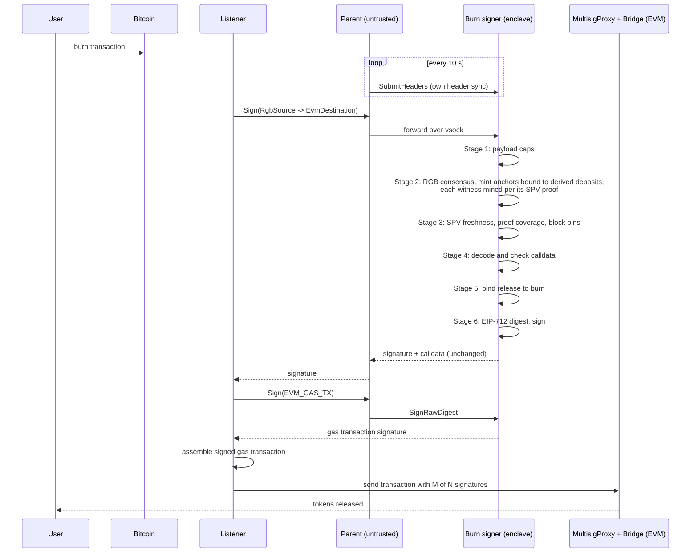

# Burn flow (RGB -> EVM)

**Signer image:** `burn-signer` (`--no-default-features --features vsock,rgb,burn-signer`).
**Checked against repository code:** 2026-10-12 (RGB 0.11.2-rc.1 port).
Deployment was not checked.

This document tells how the burn signer checks and signs a release. The
[spec](tee-spec.md) describes the rules and known limits. If the code and this
document differ, investigate the difference. Either can contain an error.

## 1. What the burn flow does

1. The user burns RGB units on Bitcoin.
2. The burn records how many units it destroys (`burnedAsset`) and which
   destination gets the tokens (`burnReason`: an EVM address, or the hash of a
   destination record, see [burn-destination.md](burn-destination.md)). It may
   return change.
3. The burn signer checks the burn.
4. The burn signer signs an EIP-712 release for `MultisigProxy`.
5. `MultisigProxy` needs M of N such signatures. Then the Bridge contract
   releases the tokens to the user.

The burn signer signs nothing on Bitcoin.

## 2. Who does what

| Part | Where | Trusted for | Job |
|------|-------|-------------|-----|
| User | Bitcoin | - | Burns RGB units. |
| Backend and listener | Operator servers | Nothing | Build the `fundsOut` calldata. Send the request. |
| Parent | EC2 host | Nothing | Moves bytes. Sends Bitcoin headers to the enclave. |
| Burn signer | Nitro Enclave | Checks and keys | Checks the burn. Signs the release and the gas transaction. |
| `MultisigProxy` and Bridge | EVM | Quorum and replay | Count signatures. Use the nonce. Check `burnId` again. |

The burn signer checks request claims before it signs. It derives the burn
amount from the consignment. It reads no Bitcoin indexer, and reads the EVM
RPC only for an asset whose genesis names a reject list (Stage 3b): the
deposits behind the burn are derived, and the witnesses are checked on chain against
the enclave's own header chain. RGB consensus takes each witness transaction
from the consignment, but treats it as mined only if a Merkle proof in the
request places it at least `SPV_MIN_CONFIRMATIONS` deep in that chain. An
unmined witness anywhere in the history fails consensus. So two conflicting
off-chain transfers of the same units cannot both back a burn: only one of
them can be mined.

On mainnet and testnet4, SPV checks witness inclusion against the enclave
header chain with proof of work. On testnet4, min-difficulty blocks count as
confirmations and freshness, for testing convenience: testnets carry no
production value. Signet and regtest do not enforce proof of work. See
[Bitcoin network limits](tee-spec.md#8-rgb--bitcoin--spv-verification).

## 3. Sequence

## 4. Key values

| Name | Value | Meaning |
|------|-------|---------|
| `TS_BURN` | 8010 | Burn transition. The only settling transition the burn signer accepts. |
| `TS_MINT` | 8013 | Mint transition. It shows in the burn's history (the ancestry). |
| `GS_BURNED_ASSET` | 2015 | Burn global: the number of units destroyed (u64). Required. |
| `GS_REJECT_LIST` | 3010 | Genesis global: where the reject list is. The enclave reads only an `IRgbRejectList` contract on `EVM_CHAIN_ID` (B3.7). |
| `GS_BURN_REASON` | 3009 | Burn global: 32 bytes. A left-padded EVM address (V0), or the hash of a destination record (V1). See [burn-destination.md](burn-destination.md). Required. |
| `RGB_CHAIN_ID` | 827166 | The bridge's id for the RGB network. Compiled in. |
| `SPV_MIN_CONFIRMATIONS` | 6 (default) | Minimum depth of each Bitcoin transaction. Image env, attested. Zero stops the boot. |
| `SPV_MAX_TIP_AGE_SECS` | 7200 | Maximum age of the header-chain tip. |
| `SPV_MAX_TIP_FUTURE_SECS` | 7200 | Maximum time the tip can be in the future. |
| `MAX_RELAY_TIP_LAG_BLOCKS` | 100 | Maximum distance from the BtcRelay tip to the enclave tip. |
| `fundsOut` selector | `0x340276aa` | Pools route. |
| `lzFundsOut` selector | from the enclave ABI | LayerZero route. |
| Calldata cap | 96 KiB | Maximum calldata size. |
| EIP-712 domain | `("MultisigProxy", "1", chainId, verifyingContract)` | Tests compare it with contract fixtures. |

## 5. Checks, in order

If one check fails, the burn signer stops. It signs nothing. It returns an
error.

### Stage 0 - Can this enclave do this request?

- **B0.1** The endpoints must be set (`SetEndpoints`).
- **B0.2** The source must be RGB and the destination must be EVM. The burn
  signer refuses a mint request.

The enclave must be `Active`, but no check runs here. Signing (Stage 6) is
the first step that reads the keys. It refuses an enclave without keys.

### Stage 1 - Is the request within the caps?

- **B1.1** The consignment must not be larger than `MAX_CONSIGNMENT_BYTES`
  (default 12 MiB).
- **B1.2** Proof count must be at most `MAX_MERKLE_PROOFS` (default 16384).
  Proof bytes must be at most `MAX_TOTAL_PROOF_BYTES` (default 8 MiB).
- **B1.3** `keccak256(consignment)` must equal `consignment_hash`. This check
  finds a damaged copy only. It is not a safety proof.

### Stage 2 - Is the RGB history valid, and is each mint backed?

- **B2.1** The bytes must be a V1 transfer file (`TFR`). The genesis schema
  must be BFA. If the genesis names a reject list (`GS_REJECT_LIST`), it must
  be an EVM contract; a URL list is refused. Consensus builds no opouts DAG
  (its edges are inputs x outputs per transition); B3.10 walks the history
  from each operation's inputs, linear in the consignment.
- **B2.2** RGB consensus phase 1 runs over the whole history under the BFA
  rules from `rgb-schemas`. Each mint leaves an anchor: its OpId and its
  `issuedSupply`.
- **B2.3** The genesis `bridgeLocation` must name the pinned
  `FUNDS_IN_CONTRACT` on `EVM_CHAIN_ID`. For each anchor, the burn signer
  derives the `operationId` of the one deposit that can back it:
  `keccak256(abi.encode(RGB_MINT_DEPOSIT_TYPEHASH, FUNDS_IN_CONTRACT,
  EVM_CHAIN_ID, TOKEN_CONTRACT, RGB_CHAIN_ID, mint OpId, minted units))`. It
  reads nothing from the chain. `TOKEN_CONTRACT` and `EVM_CHAIN_ID` must be
  pinned.
- **B2.4** Consensus phase 2 confirms each anchor only against its derived
  lock, one for one. The Bridge holds a record under that id only if a
  deposit of exactly the minted units was made for that mint, and the release
  checks each cited record, so a mint with no deposit fails on chain.
- **B2.5** The result is a list of locks: `(operationId, netAmount)`. One burn
  has one list, so one `settlementData`; `burnId` does not hash it. Stage 5
  uses this list.
- **B2.6** The contract id must equal the declared `asset_id` and the pinned
  `RGB_ASSET_ID`.
- **B2.7** The settling transition must be `TS_BURN`: the burn of the last
  witness, so one tx can also carry a plain transfer. Two burns there are
  refused. The amount comes from `burnedAsset`, never from the outputs or the
  host.
- **B2.8** Consensus phase 2 resolves every witness, the burn included, on
  chain: the transaction comes from the consignment, its block from the
  request's Merkle proof for it. That proof must pass B3.4 and B3.5 first. A
  witness with no such proof is unmined and fails consensus. A proof the
  consignment itself carries is never used. Stage 3 runs these proof checks
  again with coverage and pins.

### Stage 3 - Is the burn buried in Bitcoin?

The parent sends block headers. The burn signer builds its own header chain.
On mainnet and the testnets, it checks linkage, proof of work, and `nBits`.
On testnet4 it applies the 20-minute rule and BIP94 (retarget from the first
block of the period, the timewarp rule). On every network a header may be at
most 2 hours ahead of the enclave clock, so a host cannot date free blocks
ahead to lower its fork's difficulty. It accepts a replacement chain only
when it has more work and meets the reorganization limits. Signet and regtest
skip proof-of-work and `nBits` checks.

- **B3.1** The chain tip must not be older than 2 hours, nor more than 2
  hours in the future. On the testnets a min-difficulty tip counts.
- **B3.2** The consignment's network (`chain_net`) must equal the enclave's
  Bitcoin network.
- **B3.3** The Merkle proofs must be exactly the set of witness transactions
  in the consignment. None missing. None extra. No duplicates.
- **B3.4** Each Merkle path must be at most 32 levels. Each proof must verify
  against the header that the enclave stores at that height.
- **B3.5** Each witness transaction must be at least `SPV_MIN_CONFIRMATIONS`
  blocks deep (default 6). On the testnets min-difficulty blocks count.
- **B3.6** The enclave records the heights and hashes it used. Just before it
  uses the key, it checks that they did not change.

### Stage 3b - Did the issuer reject the burned units?

Only for an asset whose genesis names a reject list. It runs last in source
validation, after the asset bind (B2.6), so a foreign genesis cannot make the
signer read a contract of its choice. The rules are those of rgb-lib 98a8af6.

- **B3.7** The list must be on `EVM_CHAIN_ID`, and the node must report it.
  Another chain is refused: the enclave has no RPC for it.
- **B3.8** Over the pinned EVM RPC: the latest block and the `finalized`
  block (capped at the latest), `length()` at both, then `entries` in pages of
  1000 at the latest block. Any RPC error, no code at the latest block, a list
  shorter at the latest block, a bad or short page, or more than 20,000
  entries refuses. About 5 calls plus one per 1000 entries; the history
  length does not matter. A call that, at the pace of the slowest call so
  far, would end within 2 s of the 30 s request deadline is not started:
  the read refuses with "exceeded the request budget".
- **B3.9** Decisions: the latest finalized entry for an opout wins. A
  pending reject counts at once, also over a finalized allow. A pending allow
  does not count. `finalized` is fixed in code, not `EVM_FINALITY_TAG`, so the
  signer never releases what an rgb-lib wallet still refuses.
- **B3.10** Each input of the settling burn is walked back through the
  history: an opout's parents are the inputs of the operation that made it,
  the reachability of rgb-lib's opouts DAG. One walk serves all inputs and
  expands each operation once. An allowed opout stops its branch. A rejected opout on a
  branch nothing stopped refuses the release. The burn's change is not
  checked: it is not released.

### Stage 4 - Is the calldata correct?

- **B4.1** Calldata must be at least 4 bytes and at most 96 KiB.
- **B4.2** The selector must be `fundsOut` (`0x340276aa`) or `lzFundsOut`.
- **B4.3** The burn signer decodes the calldata and encodes it again. The two
  must be byte-equal. This stops a non-canonical encoding.
- **B4.4** The decoded amount must equal the request's `calldata_amount`. It
  must fit in a u64.
- **B4.5** `chain_id` must equal the pinned `EVM_CHAIN_ID`. `proxy_contract`
  must equal the pinned `EVM_PROXY_CONTRACT_ADDRESS`.
- **B4.6** `destinationChainId`:
  - pools route: must equal `EVM_CHAIN_ID`;
  - LayerZero route: must not be zero, and must not equal `EVM_CHAIN_ID`.
- **B4.7** The deadline must be in the future, and at most 1 day after now
  (`MAX_TEE_DEADLINE_SECS`, the same value as `MultisigProxy.MAX_TEE_DEADLINE`).
  So every signature expires 1 day after signing.
- **B4.8** LayerZero route only: `minAmountLD` must be > 0 and at most `amount`.
  The backend sets it from the net quoted at signing.
- **B4.9** LayerZero route only: `extraOptions` must be empty or one executor
  `lzReceive` gas option (type 3, no value), with gas at most
  `MAX_LZ_RECEIVE_GAS`. Native drop, compose and every other option are refused.

### Stage 5 - Does the release belong to this burn?

Both routes (`fundsOut` and `lzFundsOut`), in this order:

- **B5.1** The burned amount must be at least the calldata amount.
- **B5.2** `sourceChainId` must equal 827166 (`RGB_CHAIN_ID`).
- **B5.3** `sourceAddress` must be empty. RGB has no source address.
- **B5.4** The burn signer calculates `burnId` the same way as
  `Bridge._deriveBurnIdFromFields`. It uses the pinned `FUNDS_IN_CONTRACT`,
  `EVM_CHAIN_ID` and `TOKEN_CONTRACT`, and the calldata fields. The calldata
  `burnId` must be equal.
- **B5.5** BtcRelay proof: the calldata `proof` is
  `(sourceHeight, sourceCommit, latestHeight, latestCommit)`, 128 bytes.
  - `sourceHeight` must be the block that holds the last witness transaction.
  - The enclave must have a header at `latestHeight`. That header must be at
    most 100 blocks below the enclave tip.
  - With `BTC_RELAY_MODE=required` (the production mode), each commit word must
    equal `keccak256` of the 160-byte BtcRelay record that the enclave builds
    from its own chain. A zero word is refused.
  - With `BTC_RELAY_MODE=none` (local stand only), both words must be zero.
    A production policy does not boot in this mode.
- **B5.6** Amount: `burnedAsset` must **equal** the calldata `amount`.
- **B5.7** Burn id: `sourceBurnTxId` must not be zero. It must equal the
  OpId of the burn transition.
- **B5.8** Destination: `burnReason` must be present.
  - High 12 bytes zero (V0): the low 20 bytes are an EVM address. The request
    must carry no `burn_destination`. Pools route only. The calldata
    `recipient` must equal the address.
  - Otherwise (V1): the request must carry `burn_destination`, and its hash
    must equal the 32 bytes ([burn-destination.md](burn-destination.md)).
    `destinationChainId` must equal the record. `dstEid == 0` means the pools
    route, with a 20-byte `recipient` equal to the calldata. `dstEid != 0`
    means the LayerZero route: the calldata `dstEid` must equal it, and the
    left-padded record `recipient` must equal the LayerZero `recipient`.
- **B5.9** Settlement: `settlementData` is
  `abi.encode(bytes32[] operationIds, uint256[] netAmounts)`. It must be
  canonical. The two arrays must have the same length. The ids must be in
  strictly ascending order, so no id repeats. The pairs must equal, as a set,
  the locks consensus confirmed in Stage 2. An empty list is refused.

> **Note - LayerZero route.** Only a V1 burn can leave via LayerZero, because
> only V1 names a chain. `min_amount_ld` is checked against the request only.

### Stage 6 - Sign

- **B6.1** The domain is `("MultisigProxy", "1", chainId, verifyingContract)`.
- **B6.2** The digest uses the **decoded fields**, never the raw bytes:
  - pools route: `TeeFundsOut(recipient, amount, burnId, sourceChainId,
    destinationChainId, sourceAddress, proof, settlementData,
    sourceBurnTxId, nonce, deadline)`;
  - LayerZero route: `TeeLzFundsOut(...)`, 14 fields.
- **B6.3** The burn signer signs with the EVM bridge key `m/44'/60'/0'/0/0`.
  The signature is 65 bytes (`r || s || v`). `v` is the raw recovery id, 0 to 3, with no +27.
- **B6.4** The response has the signature and the calldata. The calldata is
  not changed.

This path creates only `TeeFundsOut` and `TeeLzFundsOut` digests. It does not
create a batch digest. The receiving contract must interpret these signatures
according to the same ABI.

## 6. The gas transaction (`SignRawDigest`)

The burn signer also signs the EVM transaction that sends the release. It
uses the gas key `m/44'/60'/0'/0/1`.

- **G1** The request must have the unsigned transaction. The enclave
  calculates the digest itself.
- **G2** RLP decode must be strict and canonical. The enclave accepts EIP-1559
  and legacy EIP-155. A transaction has at most 1024 RLP items and at most
  1 MiB. So the input bounds the decoder's memory.
- **G3** `chain_id` must equal `EVM_CHAIN_ID`. `to` must equal
  `GAS_TX_ALLOWED_TO`. Contract creation is refused.
- **G4** `gasLimit` must be at most `GAS_TX_MAX_GAS_LIMIT`. Each fee field must
  be at most `GAS_TX_MAX_FEE_PER_GAS`.
- **G5** Calldata must start with a selector in `GAS_TX_ALLOWED_SELECTORS`.
  Empty calldata is refused.
- **G6** `value` must be zero. One exception: the payable `lzFundsOutCall` to
  `EVM_PROXY_CONTRACT_ADDRESS`, with `value` at most `GAS_TX_MAX_VALUE_WEI`.
- **G7** The destination, gas ceiling, fee ceiling, and selector allowlist
  must be configured. An unset value ceiling prevents non-zero `value`. It
  does not prevent a transaction with zero `value`.

The gas rule is part of the attested policy. The gas transaction is not
linked to one checked release. The limits apply to one transaction, not to a
sum of transactions.

## 7. Replay

The burn signer keeps no replay state for releases. Replay protection is on
chain:

- the `MultisigProxy` nonce is in the signed digest;
- the Bridge refuses a `burnId` that it used before.

On both routes, `burnId` is bound to the burn through B5.3, B5.6 and B5.7.

## 8. What the burn signer refuses

| Request | Result |
|---------|--------|
| `Sign` with an EVM source or an RGB destination (mint) | Refused: wrong signer role. |
| `SignBtc` | Refused: wrong signer role. |
| `SignRightsRefill` | Refused: wrong signer role. The burn signer holds no mint rights. |
| `SignCcd` | Refused: not in this build. |
| `SignRawMessage` | Refused in every build. |

## 9. The main idea

The amount and the payee of a burn are its `burnedAsset` and `burnReason`
globals. So the burn signer needs three proofs that agree:

1. RGB consensus: the burn and its whole history are valid, and every mint in
   it is confirmed against the deposit it derives.
2. SPV: every witness transaction of the history is buried, and consensus
   saw each one as mined (B2.8).
3. Globals: the amount and the payee in the burn equal those in the calldata.

The contract proves that the cited deposits exist. The burn signer proves that
they are the deposits behind this burn (B5.9). Each half needs the other.
