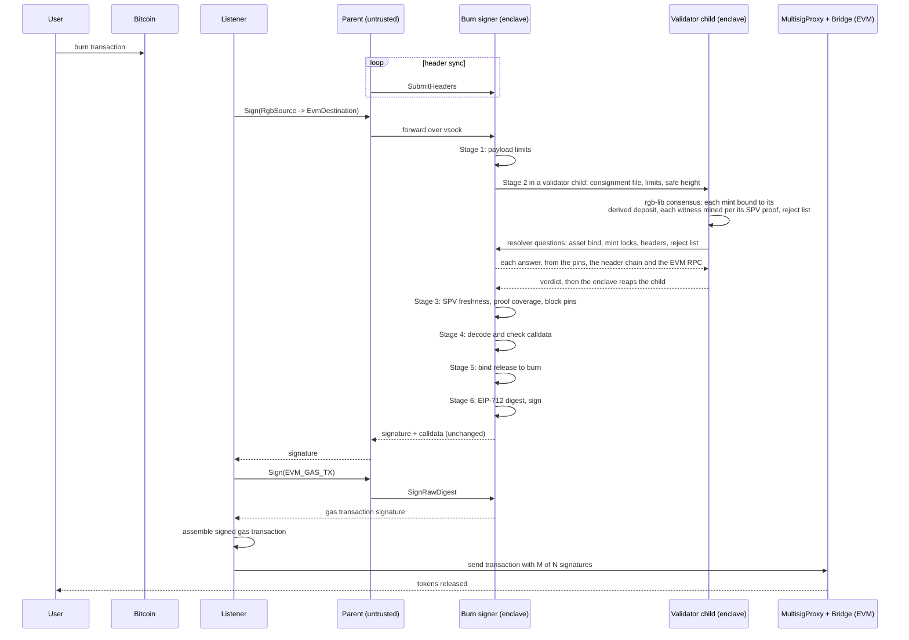

# Burn flow (RGB -> EVM)

- **Signer image:** `burn-signer`
  (`--no-default-features --features vsock,burn-signer`).
- **Checked against repository code:** 2026-11-10, rgb-lib-bfa 5010eefa
  (RGB-Tools bfa 66bae096). Deployment was not checked.

This document gives the checks of the burn signer, in order. The
[specification](tee-spec.md) gives the trust model, the SPV rules and the
known limits. If the code and this document differ, investigate the
difference. Either can contain an error.

## 1. What the burn flow does

1. The user burns RGB units on Bitcoin.
2. The burn records how many units it destroys (`burnedAsset`) and which
   destination gets the tokens (`burnReason`: an EVM address, or the hash of a
   destination record, see [burn-destination.md](burn-destination.md)).
3. The burn signer checks the burn.
4. The burn signer signs an EIP-712 release for `MultisigProxy`.
5. `MultisigProxy` needs M of N such signatures. Then the Bridge contract
   releases the tokens to the user.

The burn signer signs nothing on Bitcoin.

A BFA burn transition has no outputs, so a burn cannot return change. When
its inputs hold more units than it destroys, rgb-lib adds a transfer to the
same transaction: the transfer splits the units and keeps the change, and the
burn destroys the other output of the split. A burn of the exact amount has
no split.

## 2. Who does what

| Part | Where | Trusted for | Job |
|------|-------|-------------|-----|
| User | Bitcoin | - | Burns RGB units. |
| Backend and listener | Operator servers | Nothing | Build the `fundsOut` calldata. Send the request. |
| Parent | EC2 host | Nothing. On public Signet: its Bitcoin headers. | Moves bytes. Sends Bitcoin headers to the enclave. |
| Burn signer | Nitro Enclave | Checks and keys | Checks the burn. Signs the release and the gas transaction. |
| Validator child | Nitro Enclave, a process of the burn signer's binary for one request | Its verdict on one consignment ([specification](tee-spec.md#validator-child-burn-signer)) | Runs rgb-lib on the consignment in Stage 2. Asks the burn signer for each resolver answer. |
| `MultisigProxy` and Bridge | EVM | Quorum and replay | Count signatures. Use the nonce. Check `burnId` again. |

The burn signer takes no claim of the request as evidence. It reads the
amount and the destination from the consignment. It derives the deposits
behind the burn from the mints in the history. It reads no Bitcoin indexer.
It reads the EVM RPC only for an asset whose genesis names a reject list
(Stage 3b).

RGB consensus counts a witness transaction as mined only when the SPV proof
the consignment carries for it places it at least `SPV_MIN_CONFIRMATIONS`
deep in the enclave's own header chain. An unmined witness anywhere in the history fails
consensus. So two conflicting transfers of the same units cannot both back a
burn: only one of them can be mined.

On public Signet the header chain checks no proof of work. There the parent's
headers decide which witnesses count as mined, so the rule above does not hold
([known limits](tee-spec.md#10-known-limits)).

## 3. Sequence

The [sequence diagram in code order](diagrams/03-seq-sign-evm.md) and the
[signing gate](diagrams/10-signing-gate.md) show the same path in more detail.

## 4. Key values

| Name | Value | Meaning |
|------|-------|---------|
| `TS_BURN` | 8010 | Burn transition. The only settling transition the burn signer accepts. |
| `TS_MINT` | 8013 | Mint transition. Each mint in the history of the burn needs a deposit. |
| `GS_BURNED_ASSET` | 2015 | Burn global: the number of units destroyed (u64). Required. |
| `GS_BURN_REASON` | 3009 | Burn global: 32 bytes that name the destination. Required. |
| `GS_REJECT_LIST` | 3010 | Genesis global: where the reject list of the asset is. |
| `RGB_CHAIN_ID` | 827166 | The bridge's id for the RGB network. Compiled in. |
| `fundsOut` selector | `0x340276aa` | Direct route. |
| `lzFundsOut` selector | from the enclave ABI | LayerZero route. |
| `MAX_TEE_DEADLINE_SECS` | 1 day | The longest time a signature stays valid. The same value as `MultisigProxy.MAX_TEE_DEADLINE`. |
| `MAX_LZ_RECEIVE_GAS` | 1,000,000 | The most gas a LayerZero `lzReceive` option may ask for. |
| `MAX_RELAY_TIP_LAG_BLOCKS` | 100 | The largest distance from the BtcRelay tip to the enclave tip. |
| EIP-712 domain | `("MultisigProxy", "1", chainId, verifyingContract)` | Independent encoders and [protocol vectors](burn-vector-provenance.md) check its format. |

`SPV_MIN_CONFIRMATIONS` is an image setting
([configuration.md](configuration.md)). The size limits named below
(`max_...`) are runtime limits ([runtime-limits.md](runtime-limits.md)). The
other SPV constants are in the
[specification](tee-spec.md#7-bitcoin-header-chain-spv).

## 5. Checks, in order

If one check fails, the burn signer stops. It signs nothing. It returns an
error.

The stages group the checks by topic, in code order with these exceptions.
Stage 3b runs inside rgb-lib, so before B3.1, B3.2 and B3.5. The burn-type
check of B2.8 runs after Stage 3. B4.8 and B4.9 run before B4.4. The
[sequence in code order](diagrams/03-seq-sign-evm.md) shows the exact order.

### Stage 0 - Can this enclave do this request?

- **B0.1** The launch values must be set (`SetEndpoints`).
- **B0.2** The source must be RGB and the destination must be EVM. The burn
  signer refuses a mint request.
- **B0.3** The enclave must be `Active`. While the keys are not ready, the
  burn signer refuses the request before any validation.

### Stage 1 - Is the request within the limits?

- **B1.1** The consignment must be at most `max_consignment_bytes`.
- **B1.2** `keccak256(consignment)` must equal `consignment_hash`. This check
  finds a damaged copy only. It is not a safety proof.

### Stage 2 - Is the RGB history valid, and is each mint backed?

The rgb-lib part of Stage 2 runs in the validator child, a process of the
burn signer's own binary that holds no key. The burn signer gives each
resolver answer itself, ends the child before the request deadline and
checks its verdict ([specification](tee-spec.md#validator-child-burn-signer)).

- **B2.1** The bytes must be a V1 transfer file. Its genesis is the one the
  `RGB_ASSET_ID` pin names (B2.7), so its schema is BFA.
- **B2.2** The contract id must pass the asset bind (B2.7) before rgb-lib
  runs. rgb-lib reads where the genesis publishes its reject list
  (`GS_REJECT_LIST`) and names it to the reject-list resolver (Stage 3b). The
  enclave reaches that address over the network, so a foreign genesis must
  not choose it. Refusing a foreign asset before rgb-lib also spares rgb-lib
  the work, which is all that ordering buys beyond the bind itself.
- **B2.3** One call of rgb-lib's `validate_consignment_with_resolver` runs
  RGB consensus over the whole history, under the BFA rules that rgb-lib's
  pinned `rgb-schemas` compiles. rgb-lib asks three resolvers, and the burn
  signer answers each question of the child: for each witness (B2.9), for
  each mint (B2.4, B2.5) and for the reject list (Stage 3b). A resolver
  error refuses the request, and so does any rgb-lib warning. rgb-lib must
  report the consignment that the child parsed.
- **B2.4** For each mint in the history, the burn signer derives the
  `operationId` of the one deposit that can back it:
  `keccak256(abi.encode(RGB_MINT_DEPOSIT_TYPEHASH, FUNDS_IN_CONTRACT,
  EVM_CHAIN_ID, TOKEN_CONTRACT, RGB_CHAIN_ID, lockId, minted units))`. The
  lockId is `LockId(mint OpId, mint witness txid)`
  ([mint-flow.md](mint-flow.md#the-lockid)). `TOKEN_CONTRACT` and
  `EVM_CHAIN_ID` must be set: without them the burn signer refuses a history
  that has a mint. The burn signer reads nothing from the chain here. It
  reports `EVM_CHAIN_ID` as the chain its resolver is connected to, and rgb-ops
  refuses the resolver unless the genesis `bridgeLocation` names that chain.
- **B2.5** rgb-lib confirms each mint only against its derived deposit, one
  for one. The Bridge holds a record under that id only if a deposit of
  exactly the minted units was made for that mint, and
  `RgbSettlementModule.beforeFundsOut` checks each cited record on chain. So
  a mint with no deposit fails on chain, when the release route uses that
  module ([known limits](tee-spec.md#10-known-limits)). The burn signer does
  not check the `beforeBlock` of a mint; the mint signer checked it before
  it signed the mint.
- **B2.6** The result is the list of the deposit `operationId`s of the
  history. Stage 5 uses it.
- **B2.7** The contract id must equal the declared `asset_id` and the pinned
  `RGB_ASSET_ID`. A contract id is the genesis commitment, so this pin admits
  one genesis: its schema, its `chain_net` and its `bridgeLocation` need no
  check of their own. The witness resolver refuses a `chain_net` other than
  the enclave's before it resolves any witness, so a wrong-network consignment
  fails consensus.
- **B2.8** The settling transition must be a `TS_BURN`, and the consignment
  must hold one. Two burns are refused, in one bundle or in two: only one of
  them could ever be released, and the order of their bundles must not decide
  which. The amount comes from `burnedAsset`, never from the outputs or the
  host. The release binds the witness tx of the burn's own bundle, which need
  not be the last bundle of the file.
- **B2.8a** The burn signer reads each transition, with its `burnedAsset`,
  `burnReason` and OpId, from rgb-lib's `inspect_consignment`, over the bundles
  that hold a terminal operation: one that nothing in the consignment builds
  on. A burn has no assignments, so nothing can spend its state and it is
  always terminal, which is what makes this selection sound here - the settling
  burn is always read, wherever its bundle sits. An ancestor is not terminal,
  since the operation spending its state is in the same file, so its bundle is
  skipped: validation, not this inspection, is what checks it. An export can
  end in more than one terminal operation, such as a burn and a later transfer
  of what it left, and then both bundles are read. The inspection indexes every
  transition of the file to resolve inputs from, and refuses a transition that
  two bundles commit. For each bundle it reads, it reverifies the witness
  commitment, resolves every transition input to the outpoint its witness
  spends, and refuses an input it cannot resolve, a transition the bundle does
  not commit under its own id, and any type the pinned BFA schema does not
  define.
- **B2.9a** A bundle discloses the transitions the history needs and conceals
  the rest: the export builds each one with
  `TransitionBundle::to_concealed_except`, then reveals each further transition
  the walk needs. So a bundle of any consignment can commit more transitions
  than it carries, the bundle of the burn included, and the burn signer does
  not require otherwise. It needs no such rule: consensus refuses a
  consignment that conceals a transition the burned units descend from, since
  the spending transition then references a previous state that cannot be
  found. What a bundle may conceal is therefore a transition the release does
  not pay for, and a concealed burn beside the settling one gets no release of
  its own.
- **B2.9** The witness resolver serves block headers of the enclave's own
  chain and looks no transaction up. rgb-lib counts a witness transaction as
  mined only when the SPV proof the consignment carries for it leads to the
  Merkle root of the header at its height (B3.3), and the enclave serves a
  header only at the required depth (B3.4), from one view of the chain for
  the whole validation ([specification](tee-spec.md#7-bitcoin-header-chain-spv)).
  A witness with no proof, or with a proof that does not hold, is unmined and
  fails consensus.

### Stage 3 - Is the burn buried in Bitcoin?

The parent sends block headers, and the burn signer builds its own header
chain from them. The [specification](tee-spec.md#7-bitcoin-header-chain-spv)
gives the header rules and the limits of each network.

- **B3.1** The chain tip must be at most `SPV_MAX_TIP_AGE_SECS` old and at
  most `SPV_MAX_TIP_FUTURE_SECS` in the future.
- **B3.2** Validation must place every witness transaction of the
  consignment in a block. None missing.
- **B3.3** Each SPV proof must verify against the header that the enclave
  stores at its height. rgb-lib makes this check: the path has at most 32
  levels and must use up the transaction position, one bit per level. It does
  not yet refuse a path node that is a 64-byte transaction (CVE-2017-12842);
  that guard comes with the next rgb-ops release.
- **B3.4** Each witness transaction must be at least `SPV_MIN_CONFIRMATIONS`
  blocks deep. Validation reads headers under short locks, so afterwards the
  enclave confirms under one lock that every header a proof was checked
  against is still in the chain at that depth. A block above the enclave's
  tip, or one not yet that deep, is a wait and not a refusal: the enclave
  answers with its own
  [error code](tee-spec.md#6-requests), and the caller retries once the
  signer has the headers.
- **B3.5** The enclave records the heights, hashes and required depths that
  it used. Just before it uses the key, it checks that no hash changed and
  that no block is shallower than its check required.

### Stage 3b - Did the issuer reject the burned units?

This stage runs only for an asset whose genesis names a reject list. rgb-lib
runs it at the end of its validation (B2.3), once every witness and mint
passed. The enclave reads only the list that the pinned asset's genesis
names. It trusts the pinned EVM RPC for the content of the list: TLS
authenticates the endpoint, not the answers.

- **B3.7** The list must be an EVM contract; the resolver refuses a URL list
  unread. The list must be on `EVM_CHAIN_ID`, and the node must report that
  chain id. A list on another chain is refused.
- **B3.8** The enclave reads the whole list on each request: `length()` at
  the `finalized` block and at the latest block, then the entries at the
  latest block, in pages of `reject_list_page_entries`. It refuses on any RPC
  error, on a contract with no code at the latest block, on a list that is
  shorter at the latest block, on a bad or short page, and on more than
  `max_reject_list_entries` entries. A contract with no code at the
  `finalized` block has no finalized entries. Before each RPC call the
  enclave refuses if a call as slow as the slowest one so far would end
  less than `RESPONSE_MARGIN` before the request deadline.
- **B3.9** The enclave gives rgb-lib the entries as read, in append order,
  and how many of them are finalized. rgb-lib decides from them: the latest
  finalized entry for an output decides, a pending reject counts at once,
  also over a finalized allow, and a pending allow does not count. rgb-lib
  refuses a count of finalized entries above the number of entries. The
  `finalized` tag is fixed in code here, not taken from `EVM_FINALITY_TAG`.
  So the signer never releases what an rgb-lib wallet still refuses.
- **B3.10** rgb-lib starts from the inputs and outputs of every terminal
  operation: the operations that nothing in the consignment builds on. It
  walks the history of each one back. An allowed output stops its branch. A
  rejected output on a branch that nothing stopped refuses the release. Three
  things follow:
  - The burn has no outputs, so the walk starts from its inputs. When there
    is a split, the walk reaches the burned units through it.
  - A split is not terminal, because the burn spends its output. So the
    change of a split is not checked.
  - A companion transfer in the same bundle is terminal too. A rejected line
    behind it refuses the release, even when the burned units are clean.

### Stage 4 - Is the calldata correct?

- **B4.1** The calldata must be at least 4 bytes and at most
  `max_funds_out_call_data_bytes`.
- **B4.2** The selector must be `fundsOut` or `lzFundsOut`.
- **B4.3** The burn signer decodes the calldata and encodes it again. The two
  must be byte-equal. This stops a non-canonical encoding.
- **B4.4** The decoded amount must equal the request's `calldata_amount`. It
  must fit in a u64.
- **B4.5** `chain_id` must equal the pinned `EVM_CHAIN_ID`. `proxy_contract`
  must equal the pinned `EVM_PROXY_CONTRACT_ADDRESS`.
- **B4.6** `destinationChainId`:
  - direct route: must equal `EVM_CHAIN_ID`;
  - LayerZero route: must not be zero, and must not equal `EVM_CHAIN_ID`.
- **B4.7** The deadline must be in the future, and at most
  `MAX_TEE_DEADLINE_SECS` after now. So every signature expires.
- **B4.8** LayerZero route only: `minAmountLD` must be above 0 and at most
  `amount`. A LayerZero request must carry `lz_release`, and a direct request
  must not.
- **B4.9** LayerZero route only: `extraOptions` must be empty or one executor
  `lzReceive` gas option with no value and at most `MAX_LZ_RECEIVE_GAS`. A
  native drop, a compose option and an `lzReceive` value move native tokens
  that the burn did not name. Every other option is refused too.

### Stage 5 - Does the release belong to this burn?

Both routes (`fundsOut` and `lzFundsOut`), in this order:

- **B5.1** The burned amount must be at least the calldata amount.
- **B5.2** `sourceChainId` must equal `RGB_CHAIN_ID`. The contracts choose
  the verifier, the settlement module and the commission by the pair of
  source and destination chain, so this field decides which contracts judge
  the release.
- **B5.3** `sourceAddress` must be empty. RGB has no source address.
- **B5.4** The burn signer computes `burnId` as
  `Bridge._deriveBurnIdFromFields` does: from the pinned `FUNDS_IN_CONTRACT`,
  `EVM_CHAIN_ID` and `TOKEN_CONTRACT`, and the calldata `amount`,
  `sourceChainId`, `sourceAddress` and `sourceBurnTxId`. The calldata
  `burnId` must be equal. `burnId` does not hash the recipient, the
  destination chain, the `proof` or `settlementData`. So one burn has one
  `burnId`, whatever the route.
- **B5.5** The calldata BtcRelay `proof` is
  `(sourceHeight, sourceCommit, latestHeight, latestCommit)`, 128 bytes.
  - `sourceHeight` must be the block that holds the witness transaction of
    the settling burn (B2.8).
  - `latestHeight` must not be below `sourceHeight`.
  - The enclave must have a header at `latestHeight`, at most
    `MAX_RELAY_TIP_LAG_BLOCKS` below its tip.
  - With `BTC_RELAY_MODE=required` (the production mode), each commit word
    must equal `keccak256` of the 160-byte BtcRelay record that the enclave
    builds from its own chain. A zero word is refused. To build a record, the
    checkpoint must carry its chainwork, each proof height must be at least
    10 blocks above the checkpoint, and its epoch start must not be below the
    checkpoint.
  - With `BTC_RELAY_MODE=none` (a local stand or a public-Signet image), both
    words must be zero.
    A production policy does not boot in this mode.
- **B5.6** Amount: `burnedAsset` must **equal** the calldata `amount`.
- **B5.7** Burn id: `sourceBurnTxId` must not be zero. It must equal the
  OpId of the burn transition, the same transition that gives the amount.
- **B5.8** Destination: `burnReason` must be present.
  - High 12 bytes zero (V0): the low 20 bytes are an EVM address. The request
    must carry no `burn_destination`. Direct route only. The calldata
    `recipient` must equal the address.
  - Otherwise (V1): the request must carry `burn_destination`, and its hash
    must equal the 32 bytes ([burn-destination.md](burn-destination.md)).
    `destinationChainId` must equal the record. `dstEid == 0` means the
    direct route, with a 20-byte `recipient` equal to the calldata.
    `dstEid != 0` means the LayerZero route: the calldata `dstEid` must equal
    it, and the left-padded record `recipient` must equal the LayerZero
    `recipient`.
- **B5.9** Settlement: `settlementData` is
  `abi.encode(bytes32[] operationIds)`. It must be canonical. The ids must be
  in strictly ascending order, so no id repeats. They must equal, as a set,
  the deposits of Stage 2 (B2.6). An empty list is refused.
- **B5.10** LayerZero route only: the pair (`destinationChainId`, `dstEid`)
  must be one of the pairs set at launch. Another pair is refused, and so is
  every pair when no pair is set. The attested policy does not commit the pairs.

Only a V1 burn can leave through LayerZero, because only V1 names a chain.
The burn does not name `minAmountLD`: it is checked against the request only
(B4.8, B6.2).

### Stage 6 - Sign

- **B6.1** The domain is `("MultisigProxy", "1", chainId, verifyingContract)`.
- **B6.2** The digest uses the **decoded fields**, never the raw bytes:
  - direct route: `TeeFundsOut(recipient, amount, burnId, sourceChainId,
    destinationChainId, sourceAddress, proof, settlementData,
    sourceBurnTxId, nonce, deadline)`;
  - LayerZero route: `TeeLzFundsOut(...)`, 14 fields. Before the digest is
    built, the request's `lz_release` (`dst_eid`, `min_amount_ld`,
    `recipient`) must equal the decoded calldata.
- **B6.3** The burn signer signs with the EVM bridge key `m/44'/60'/0'/0/0`.
  The signature is 65 bytes (`r || s || v`). `v` is the raw recovery id, 0 to
  3, with no +27.
- **B6.4** The response has the signature and the calldata. The calldata is
  not changed.

The burn signer builds only these two digests. It builds no batch digest. The
receiving contract must read the signature under the same ABI.

## 6. The gas transaction (`SignRawDigest`)

The burn signer also signs the EVM transaction that sends the release. It
uses the gas key `m/44'/60'/0'/0/1`.

- **G1** The request must carry the unsigned transaction. The enclave
  computes the digest itself. It signs no digest that a caller supplies.
- **G2** The RLP decode must be strict and canonical. The enclave accepts
  EIP-1559 and legacy EIP-155 transactions, of at most `max_gas_tx_bytes` and
  `max_rlp_items`. So the input bounds the memory of the decoder.
- **G3** `chain_id` must equal `EVM_CHAIN_ID`. `to` must equal
  `GAS_TX_ALLOWED_TO`. Contract creation is refused.
- **G4** `gasLimit` must be at most the runtime limit `gas_tx_max_gas_limit`
  ([runtime-limits.md](runtime-limits.md)). Each fee field must be at most
  the runtime limit `gas_tx_max_fee_per_gas`. Together they bound the fee of
  one transaction. The operator can change both.
- **G5** The calldata must start with a selector in
  `GAS_TX_ALLOWED_SELECTORS`. Empty calldata is refused: a bare call still
  runs the `fallback` or `receive` function of the destination.
- **G6** `value` must be zero. One exception: the payable `lzFundsOutCall`,
  which carries the LayerZero messaging fee. It needs `to` equal to
  `EVM_PROXY_CONTRACT_ADDRESS` and `value` at most the runtime limit
  `gas_tx_max_value_wei`, and its selector must still be in the allowlist.
- **G7** The destination and the selector allowlist must be set. An unset
  value refuses the request.

A `Production` policy attests the destination and the selectors, so a verifier
can check them. A public-Signet image only measures them. The three runtime
limits are not attested. The limits apply to one transaction,
not to a sum of transactions. A gas transaction is not linked to one checked
release, and the LayerZero fee is not a field of `TeeLzFundsOut`. The enclave
does not check who receives the fees.

## 7. Replay

The burn signer keeps no replay state for releases. Replay protection is on
chain:

- the `MultisigProxy` nonce is in the signed digest;
- the Bridge refuses a `burnId` that it used before.

On both routes, `burnId` is bound to the burn through B5.2, B5.3, B5.4, B5.6
and B5.7.

## 8. What the burn signer refuses

| Request | Result |
|---------|--------|
| `Sign` with an EVM source or an RGB destination (mint) | Refused: wrong signer role. |
| `SignBtc` | Refused: wrong signer role. |
| `SignRightsRefill` | Refused: wrong signer role. The burn signer holds no mint rights. |
| `SignRawMessage` | Refused in every build. |

## 9. The main idea

The amount and the payee of a burn are its `burnedAsset` and `burnReason`
globals. So the burn signer needs three proofs that agree:

1. RGB consensus: the burn and its whole history are valid, and every mint in
   it is confirmed against the deposit it derives.
2. SPV: every witness transaction of the history is buried, and consensus
   saw each one as mined (B2.9).
3. Globals: the amount and the payee in the burn equal those in the calldata.

`RgbSettlementModule` proves that the cited deposits exist. The burn signer
proves that they are the deposits behind this burn (B5.9). Each half needs
the other.

## 10. Validation time

No check bounds the work of rgb-lib on a consignment before it runs. The
request deadline bounds it: the burn signer ends its validator child at the
kill time, before the deadline, so rgb-lib never runs past it
([specification](tee-spec.md#validator-child-burn-signer)).

A burn whose validation is ended this way is refused with error code 10
([specification](tee-spec.md#63-errors)), also when the time runs out
while the enclave reads the reject list: that read is the last step of a
validation, so a slow one leaves it too little time, and the enclave makes
no call that no longer fits the deadline. The refusal says nothing about
the consignment. The same consignment can pass a later request, when the enclave
runs fewer validations at once. A consignment that one validation alone
cannot finish within the deadline is refused on every request, until the
operator raises `total_request_timeout_secs`
([runtime-limits.md](runtime-limits.md)).

`max_consignment_bytes` bounds the file. The memory of a validation follows
from it and from the other inputs of the memory model: the entries of the
reject list (`max_reject_list_entries`), the workers, the scratch file, the
frames and the reserve of each validator child
([runtime-limits.md](runtime-limits.md)).
