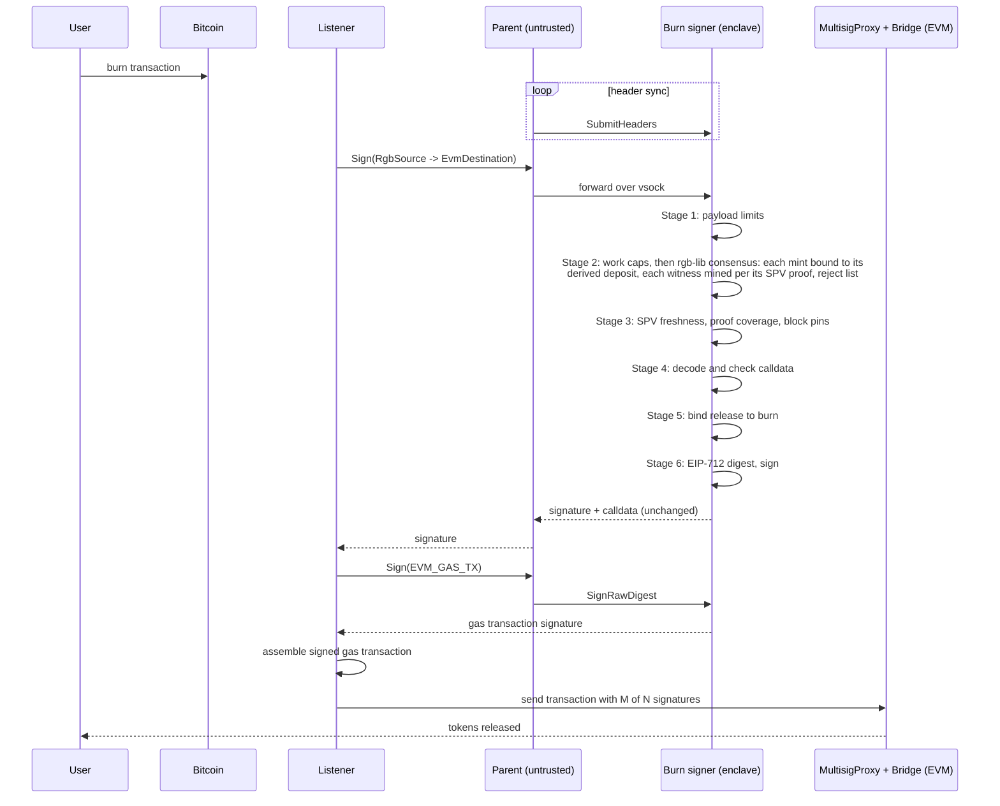

# Burn flow (RGB -> EVM)

- **Signer image:** `burn-signer`
  (`--no-default-features --features vsock,spv,burn-signer`).
- **Checked against repository code:** 2026-11-10, rgb-lib-bfa 5010eefa
  (RGB-Tools bfa 66bae096). Deployment was not checked.

This document gives the checks of the burn signer, in order. The
[specification](tee-spec.md) gives the trust model, the SPV rules and the
known limits. If the code and this document differ, investigate the
difference. Either can contain an error.

## 1. What the burn flow does

1. The user burns RGB units on Bitcoin.
2. The burn records how many units it destroys (`burnedAsset`) and which
   destination gets the tokens (`burnReason`: an EVM address, or the hash of a
   destination record, see [burn-destination.md](burn-destination.md)).
3. The burn signer checks the burn.
4. The burn signer signs an EIP-712 release for `MultisigProxy`.
5. `MultisigProxy` needs M of N such signatures. Then the Bridge contract
   releases the tokens to the user.

The burn signer signs nothing on Bitcoin.

A BFA burn transition has no outputs, so a burn cannot return change. When
its inputs hold more units than it destroys, rgb-lib adds a transfer to the
same transaction: the transfer splits the units and keeps the change, and the
burn destroys the other output of the split. A burn of the exact amount has
no split.

## 2. Who does what

| Part | Where | Trusted for | Job |
|------|-------|-------------|-----|
| User | Bitcoin | - | Burns RGB units. |
| Backend and listener | Operator servers | Nothing | Build the `fundsOut` calldata. Send the request. |
| Parent | EC2 host | Nothing | Moves bytes. Sends Bitcoin headers to the enclave. |
| Burn signer | Nitro Enclave | Checks and keys | Checks the burn. Signs the release and the gas transaction. |
| `MultisigProxy` and Bridge | EVM | Quorum and replay | Count signatures. Use the nonce. Check `burnId` again. |

The burn signer takes no claim of the request as evidence. It reads the
amount and the destination from the consignment. It derives the deposits
behind the burn from the mints in the history. It reads no Bitcoin indexer.
It reads the EVM RPC only for an asset whose genesis names a reject list
(Stage 3b).

RGB consensus counts a witness transaction as mined only when a Merkle proof
of the request places it at least `SPV_MIN_CONFIRMATIONS` deep in the
enclave's own header chain. An unmined witness anywhere in the history fails
consensus. So two conflicting transfers of the same units cannot both back a
burn: only one of them can be mined.

**A build without `spv`.** The stage-signet profile builds the burn signer
without `spv`. That build runs on public Signet only and attests
`Development`. It takes the status and depth of each witness from the pinned
indexer and trusts that answer. Stage 3 does not run, and B5.5 is reversed:
the request must carry no Merkle proofs and an empty `proof`
([known limits](tee-spec.md#10-known-limits)).

The indexer adapter uses the upstream witness resolvers that rgb-lib uses.
The enclave checks the returned transaction's txid and enforces the required
depth against the session's starting tip. For Electrum, it also checks the
Merkle proof with its shared verifier and binds the verbose answer's block
hash to the header. The pinned resolver returns neither the proof nor the
block hash with its witness answer, so these checks need separate reads.
The header still comes from the trusted indexer, not an enclave header chain.

Electrum block discovery follows the pinned upstream resolver: it refreshes
the tip for each witness, accounts for queued header notifications, and
searches around its estimated height. Without notifications, it tries the
estimate and one block on either side. A node further ahead of its index can
make resolution fail; the enclave does not fall back to unchecked status.
The server requirements are in [configuration](configuration.md#launch-values).

## 3. Sequence

The [sequence diagram in code order](diagrams/03-seq-sign-evm.md) and the
[signing gate](diagrams/10-signing-gate.md) show the same path in more detail.

## 4. Key values

| Name | Value | Meaning |
|------|-------|---------|
| `TS_BURN` | 8010 | Burn transition. The only settling transition the burn signer accepts. |
| `TS_MINT` | 8013 | Mint transition. Each mint in the history of the burn needs a deposit. |
| `GS_BURNED_ASSET` | 2015 | Burn global: the number of units destroyed (u64). Required. |
| `GS_BURN_REASON` | 3009 | Burn global: 32 bytes that name the destination. Required. |
| `GS_REJECT_LIST` | 3010 | Genesis global: where the reject list of the asset is. |
| `RGB_CHAIN_ID` | 827166 | The bridge's id for the RGB network. Compiled in. |
| `fundsOut` selector | `0x340276aa` | Direct (pools) route. |
| `lzFundsOut` selector | from the enclave ABI | LayerZero route. |
| `MAX_TEE_DEADLINE_SECS` | 1 day | The longest time a signature stays valid. The same value as `MultisigProxy.MAX_TEE_DEADLINE`. |
| `MAX_LZ_RECEIVE_GAS` | 1,000,000 | The most gas a LayerZero `lzReceive` option may ask for. |
| `MAX_RELAY_TIP_LAG_BLOCKS` | 100 | The largest distance from the BtcRelay tip to the enclave tip. |
| EIP-712 domain | `("MultisigProxy", "1", chainId, verifyingContract)` | Tests compare it with contract fixtures. |

`SPV_MIN_CONFIRMATIONS` is an image setting
([configuration.md](configuration.md)). The size and work limits named below
(`max_...`) are runtime limits ([runtime-limits.md](runtime-limits.md)). The
other SPV constants are in the
[specification](tee-spec.md#7-bitcoin-header-chain-spv).

## 5. Checks, in order

If one check fails, the burn signer stops. It signs nothing. It returns an
error.

The stages group the checks by topic, in code order with these exceptions.
B3.4 and B3.5 also run before Stage 2, for every proof of the request. Stage
3b runs inside rgb-lib, so before B3.1 to B3.3 and B3.6. The burn-type check
of B2.8 runs after Stage 3. B4.8 and B4.9 run before B4.4. The
[sequence in code order](diagrams/03-seq-sign-evm.md) shows the exact order.

### Stage 0 - Can this enclave do this request?

- **B0.1** The launch values must be set (`SetEndpoints`).
- **B0.2** The source must be RGB and the destination must be EVM. The burn
  signer refuses a mint request.
- **B0.3** The enclave must be `Active`. While the keys are not ready, the
  burn signer refuses the request before any validation.

### Stage 1 - Is the request within the limits?

- **B1.1** The consignment must be at most `max_consignment_bytes`.
- **B1.2** The request must carry at most `max_merkle_proofs` proofs, of at
  most `max_total_proof_bytes` together.
- **B1.3** `keccak256(consignment)` must equal `consignment_hash`. This check
  finds a damaged copy only. It is not a safety proof.

### Stage 2 - Is the RGB history valid, and is each mint backed?

- **B2.1** The bytes must be a V1 transfer file. The genesis schema must be
  BFA.
- **B2.2** Before rgb-lib runs, the contract id must pass the asset bind
  (B2.7). So a foreign genesis never reaches rgb-lib, and it cannot choose
  what the enclave reads. Then, if the genesis names a reject list
  (`GS_REJECT_LIST`), it must be an EVM contract; a URL list is refused. Last,
  the enclave bounds the work that rgb-lib would do on the transfer and
  refuses one above a work cap ([section 10](#10-work-caps)).
- **B2.3** One call of rgb-lib's `validate_consignment_with_resolver` runs
  RGB consensus over the whole history, under the BFA rules of the pinned
  `rgb-schemas`. rgb-lib asks three resolvers of the enclave: for each
  witness (B2.9), for each mint (B2.4, B2.5) and for the reject list (Stage
  3b). A resolver error refuses the request, and so does any rgb-lib warning.
  rgb-lib must report the consignment that the enclave parsed.
- **B2.4** For each mint in the history, the burn signer derives the
  `operationId` of the one deposit that can back it:
  `keccak256(abi.encode(RGB_MINT_DEPOSIT_TYPEHASH, FUNDS_IN_CONTRACT,
  EVM_CHAIN_ID, TOKEN_CONTRACT, RGB_CHAIN_ID, lockId, minted units))`. The
  lockId is `LockId(mint OpId, mint witness txid)`
  ([mint-flow.md](mint-flow.md#the-lockid)). The genesis `bridgeLocation` must
  name the pinned `FUNDS_IN_CONTRACT` on `EVM_CHAIN_ID`. `TOKEN_CONTRACT` and
  `EVM_CHAIN_ID` must be set: without them the burn signer refuses a history
  that has a mint. The burn signer reads nothing from the chain here.
- **B2.5** rgb-lib confirms each mint only against its derived deposit, one
  for one. The Bridge holds a record under that id only if a deposit of
  exactly the minted units was made for that mint, and
  `RgbSettlementModule.beforeFundsOut` checks each cited record on chain. So
  a mint with no deposit fails on chain, when the release route uses that
  module ([known limits](tee-spec.md#10-known-limits)). The burn signer does
  not check the `beforeBlock` of a mint; the mint signer checked it before
  it signed the mint.
- **B2.6** The result is the list of the deposit `operationId`s of the
  history. Stage 5 uses it.
- **B2.7** The contract id must equal the declared `asset_id` and the pinned
  `RGB_ASSET_ID`.
- **B2.8** The settling transition must be a `TS_BURN`: the burn of the last
  witness bundle. Two burns there are refused. The amount comes from
  `burnedAsset`, never from the outputs or the host. The burn signer reads
  the burn facts (`burnedAsset`, `burnReason`, the OpId) from the validated
  transfer, and a summary of every transition from rgb-lib's
  `inspect_consignment` on the same file. The two readings must name the same
  settling transition.
- **B2.9** The witness resolver counts a witness transaction as mined only
  through the Merkle proof that the request carries for it. That proof must
  pass B3.4 and B3.5 first. A witness with no such proof is unmined and fails
  consensus. A proof inside the consignment is never used.

### Stage 3 - Is the burn buried in Bitcoin?

The parent sends block headers, and the burn signer builds its own header
chain from them. The [specification](tee-spec.md#7-bitcoin-header-chain-spv)
gives the header rules and the limits of each network.

- **B3.1** The chain tip must be at most `SPV_MAX_TIP_AGE_SECS` old and at
  most `SPV_MAX_TIP_FUTURE_SECS` in the future.
- **B3.2** The consignment's network (`chain_net`) must equal the enclave's
  Bitcoin network.
- **B3.3** The Merkle proofs must be exactly the set of witness transactions
  in the consignment. None missing. None extra. No duplicates.
- **B3.4** Each Merkle path must be at most `MAX_MERKLE_PATH_DEPTH` levels.
  Each proof must verify against the header that the enclave stores at that
  height. The path must use up the transaction position, one bit per level.
  No node hashed on the path may be a 64-byte transaction (CVE-2017-12842).
- **B3.5** Each witness transaction must be at least `SPV_MIN_CONFIRMATIONS`
  blocks deep.
- **B3.6** The enclave records the heights, hashes and required depths that
  it used. Just before it uses the key, it checks that no hash changed and
  that no block is shallower than its check required.

### Stage 3b - Did the issuer reject the burned units?

This stage runs only for an asset whose genesis names a reject list. rgb-lib
runs it at the end of its validation (B2.3), once every witness and mint
passed. The enclave reads only the list that the pinned asset's genesis
names. It trusts the pinned EVM RPC for the content of the list: TLS
authenticates the endpoint, not the answers.

- **B3.7** The list must be on `EVM_CHAIN_ID`, and the node must report that
  chain id. A list on another chain is refused.
- **B3.8** The enclave reads the whole list on each request: `length()` at
  the `finalized` block and at the latest block, then the entries at the
  latest block, in pages of `reject_list_page_entries`. It refuses on any RPC
  error, on a contract with no code at the latest block, on a list that is
  shorter at the latest block, on a bad or short page, and on more than
  `max_reject_list_entries` entries. A contract with no code at the
  `finalized` block has no finalized entries. Before each RPC call the
  enclave refuses if a call as slow as the slowest one so far would end
  less than `RESPONSE_MARGIN` before the request deadline.
- **B3.9** The latest finalized entry for an output decides. A pending
  reject counts at once, also over a finalized allow. A pending allow does
  not count. The `finalized` tag is fixed in code here, not taken from
  `EVM_FINALITY_TAG`. So the signer never releases what an rgb-lib wallet
  still refuses.
- **B3.10** rgb-lib starts from the inputs and outputs of every terminal
  operation: the operations that nothing in the consignment builds on. It
  walks the history of each one back. An allowed output stops its branch. A
  rejected output on a branch that nothing stopped refuses the release. Three
  things follow:
  - The burn has no outputs, so the walk starts from its inputs. When there
    is a split, the walk reaches the burned units through it.
  - A split is not terminal, because the burn spends its output. So the
    change of a split is not checked.
  - A companion transfer in the same bundle is terminal too. A rejected line
    behind it refuses the release, even when the burned units are clean.

### Stage 4 - Is the calldata correct?

- **B4.1** The calldata must be at least 4 bytes and at most
  `max_funds_out_call_data_bytes`.
- **B4.2** The selector must be `fundsOut` or `lzFundsOut`.
- **B4.3** The burn signer decodes the calldata and encodes it again. The two
  must be byte-equal. This stops a non-canonical encoding.
- **B4.4** The decoded amount must equal the request's `calldata_amount`. It
  must fit in a u64.
- **B4.5** `chain_id` must equal the pinned `EVM_CHAIN_ID`. `proxy_contract`
  must equal the pinned `EVM_PROXY_CONTRACT_ADDRESS`.
- **B4.6** `destinationChainId`:
  - direct route: must equal `EVM_CHAIN_ID`;
  - LayerZero route: must not be zero, and must not equal `EVM_CHAIN_ID`.
- **B4.7** The deadline must be in the future, and at most
  `MAX_TEE_DEADLINE_SECS` after now. So every signature expires.
- **B4.8** LayerZero route only: `minAmountLD` must be above 0 and at most
  `amount`. A LayerZero request must carry `lz_release`, and a direct request
  must not.
- **B4.9** LayerZero route only: `extraOptions` must be empty or one executor
  `lzReceive` gas option with no value and at most `MAX_LZ_RECEIVE_GAS`. A
  native drop, a compose option and an `lzReceive` value move native tokens
  that the burn did not name. Every other option is refused too.

### Stage 5 - Does the release belong to this burn?

Both routes (`fundsOut` and `lzFundsOut`), in this order:

- **B5.1** The burned amount must be at least the calldata amount.
- **B5.2** `sourceChainId` must equal `RGB_CHAIN_ID`. The contracts choose
  the verifier, the settlement module and the commission by the pair of
  source and destination chain, so this field decides which contracts judge
  the release.
- **B5.3** `sourceAddress` must be empty. RGB has no source address.
- **B5.4** The burn signer computes `burnId` as
  `Bridge._deriveBurnIdFromFields` does: from the pinned `FUNDS_IN_CONTRACT`,
  `EVM_CHAIN_ID` and `TOKEN_CONTRACT`, and the calldata `amount`,
  `sourceChainId`, `sourceAddress` and `sourceBurnTxId`. The calldata
  `burnId` must be equal. `burnId` does not hash the recipient, the
  destination chain, the `proof` or `settlementData`. So one burn has one
  `burnId`, whatever the route.
- **B5.5** The calldata BtcRelay `proof` is
  `(sourceHeight, sourceCommit, latestHeight, latestCommit)`, 128 bytes.
  - `sourceHeight` must be the block that holds the last witness transaction.
  - `latestHeight` must not be below `sourceHeight`.
  - The enclave must have a header at `latestHeight`, at most
    `MAX_RELAY_TIP_LAG_BLOCKS` below its tip.
  - With `BTC_RELAY_MODE=required` (the production mode), each commit word
    must equal `keccak256` of the 160-byte BtcRelay record that the enclave
    builds from its own chain. A zero word is refused. To build a record, the
    checkpoint must carry its chainwork, each proof height must be at least
    10 blocks above the checkpoint, and its epoch start must not be below the
    checkpoint.
  - With `BTC_RELAY_MODE=none` (a local stand only), both words must be zero.
    A production policy does not boot in this mode.
- **B5.6** Amount: `burnedAsset` must **equal** the calldata `amount`.
- **B5.7** Burn id: `sourceBurnTxId` must not be zero. It must equal the
  OpId of the burn transition, the same transition that gives the amount.
- **B5.8** Destination: `burnReason` must be present.
  - High 12 bytes zero (V0): the low 20 bytes are an EVM address. The request
    must carry no `burn_destination`. Direct route only. The calldata
    `recipient` must equal the address.
  - Otherwise (V1): the request must carry `burn_destination`, and its hash
    must equal the 32 bytes ([burn-destination.md](burn-destination.md)).
    `destinationChainId` must equal the record. `dstEid == 0` means the
    direct route, with a 20-byte `recipient` equal to the calldata.
    `dstEid != 0` means the LayerZero route: the calldata `dstEid` must equal
    it, and the left-padded record `recipient` must equal the LayerZero
    `recipient`.
- **B5.9** Settlement: `settlementData` is
  `abi.encode(bytes32[] operationIds)`. It must be canonical. The ids must be
  in strictly ascending order, so no id repeats. They must equal, as a set,
  the deposits of Stage 2 (B2.6). An empty list is refused.

Only a V1 burn can leave through LayerZero, because only V1 names a chain.
The burn does not name `minAmountLD`: it is checked against the request only
(B4.8, B6.2).

### Stage 6 - Sign

- **B6.1** The domain is `("MultisigProxy", "1", chainId, verifyingContract)`.
- **B6.2** The digest uses the **decoded fields**, never the raw bytes:
  - direct route: `TeeFundsOut(recipient, amount, burnId, sourceChainId,
    destinationChainId, sourceAddress, proof, settlementData,
    sourceBurnTxId, nonce, deadline)`;
  - LayerZero route: `TeeLzFundsOut(...)`, 14 fields. Before the digest is
    built, the request's `lz_release` (`dst_eid`, `min_amount_ld`,
    `recipient`) must equal the decoded calldata.
- **B6.3** The burn signer signs with the EVM bridge key `m/44'/60'/0'/0/0`.
  The signature is 65 bytes (`r || s || v`). `v` is the raw recovery id, 0 to
  3, with no +27.
- **B6.4** The response has the signature and the calldata. The calldata is
  not changed.

The burn signer builds only these two digests. It builds no batch digest. The
receiving contract must read the signature under the same ABI.

## 6. The gas transaction (`SignRawDigest`)

The burn signer also signs the EVM transaction that sends the release. It
uses the gas key `m/44'/60'/0'/0/1`.

- **G1** The request must carry the unsigned transaction. The enclave
  computes the digest itself. It signs no digest that a caller supplies.
- **G2** The RLP decode must be strict and canonical. The enclave accepts
  EIP-1559 and legacy EIP-155 transactions, of at most `max_gas_tx_bytes` and
  `max_rlp_items`. So the input bounds the memory of the decoder.
- **G3** `chain_id` must equal `EVM_CHAIN_ID`. `to` must equal
  `GAS_TX_ALLOWED_TO`. Contract creation is refused.
- **G4** `gasLimit` must be at most `GAS_TX_MAX_GAS_LIMIT`. Each fee field
  must be at most `GAS_TX_MAX_FEE_PER_GAS`. Together they bound the fee of
  one transaction.
- **G5** The calldata must start with a selector in
  `GAS_TX_ALLOWED_SELECTORS`. Empty calldata is refused: a bare call still
  runs the `fallback` or `receive` function of the destination.
- **G6** `value` must be zero. One exception: the payable `lzFundsOutCall`,
  which carries the LayerZero messaging fee. It needs `to` equal to
  `EVM_PROXY_CONTRACT_ADDRESS` and `value` at most `GAS_TX_MAX_VALUE_WEI`,
  and its selector must still be in the allowlist.
- **G7** The destination, the gas ceiling, the fee ceiling and the selector
  allowlist must be set. An unset value refuses the request. An unset value
  ceiling refuses only a non-zero `value`.

A `Production` policy attests the gas rule, so a verifier can check it. A
build without `spv` only measures it. The limits apply to one transaction,
not to a sum of transactions. A gas transaction is not linked to one checked
release, and the LayerZero fee is not a field of `TeeLzFundsOut`. The enclave
does not check who receives the fees.

## 7. Replay

The burn signer keeps no replay state for releases. Replay protection is on
chain:

- the `MultisigProxy` nonce is in the signed digest;
- the Bridge refuses a `burnId` that it used before.

On both routes, `burnId` is bound to the burn through B5.2, B5.3, B5.4, B5.6
and B5.7.

## 8. What the burn signer refuses

| Request | Result |
|---------|--------|
| `Sign` with an EVM source or an RGB destination (mint) | Refused: wrong signer role. |
| `SignBtc` | Refused: wrong signer role. |
| `SignRightsRefill` | Refused: wrong signer role. The burn signer holds no mint rights. |
| `SignRawMessage` | Refused in every build. |

## 9. The main idea

The amount and the payee of a burn are its `burnedAsset` and `burnReason`
globals. So the burn signer needs three proofs that agree:

1. RGB consensus: the burn and its whole history are valid, and every mint in
   it is confirmed against the deposit it derives.
2. SPV: every witness transaction of the history is buried, and consensus
   saw each one as mined (B2.9).
3. Globals: the amount and the payee in the burn equal those in the calldata.

`RgbSettlementModule` proves that the cited deposits exist. The burn signer
proves that they are the deposits behind this burn (B5.9). Each half needs
the other.

## 10. Work caps

The request deadline does not stop a worker. So the burn signer bounds the
work of rgb-lib on a consignment before rgb-lib runs (B2.2). Four runtime
limits apply:

| Limit | What it bounds |
|-------|----------------|
| `max_witness_check_cost` | The checks of each transition against the witness transaction and the anchor of its bundle. |
| `max_bundle_id_cost` | The hashing of bundle ids over the input map of each bundle. |
| `max_reject_walk_cost` | For an asset with a reject list: the steps of the walk of B3.10. |
| `max_rgb_lib_ms` | The modeled time of rgb-lib's validation and inspection: the file, its outputs, its operations, the genesis hashes and the three costs above. |

The first two bound work of rgb-lib that grows faster than the file: an
honest bundle has one or two transitions, and a forged bundle can have
thousands. The third bounds a count of the reject walk, one walk for each
origin. The time budget bounds the sum. A refusal states the cost that
passed its limit and the value of the limit.

An honest burn is far below the caps. The widest burn that the bridge
expects, 2810 mints burned by one transition, uses about 6 percent of the
witness cap and 4 percent of the bundle id cap, and it models at about a
fifth of the time budget.

The time budget can refuse an honest burn with a very long history. The
operator can raise each limit on a running enclave
([runtime-limits.md](runtime-limits.md)).
[validation-cost-model.md](validation-cost-model.md) has the model, its
measurements and the honest shapes that it refuses.
