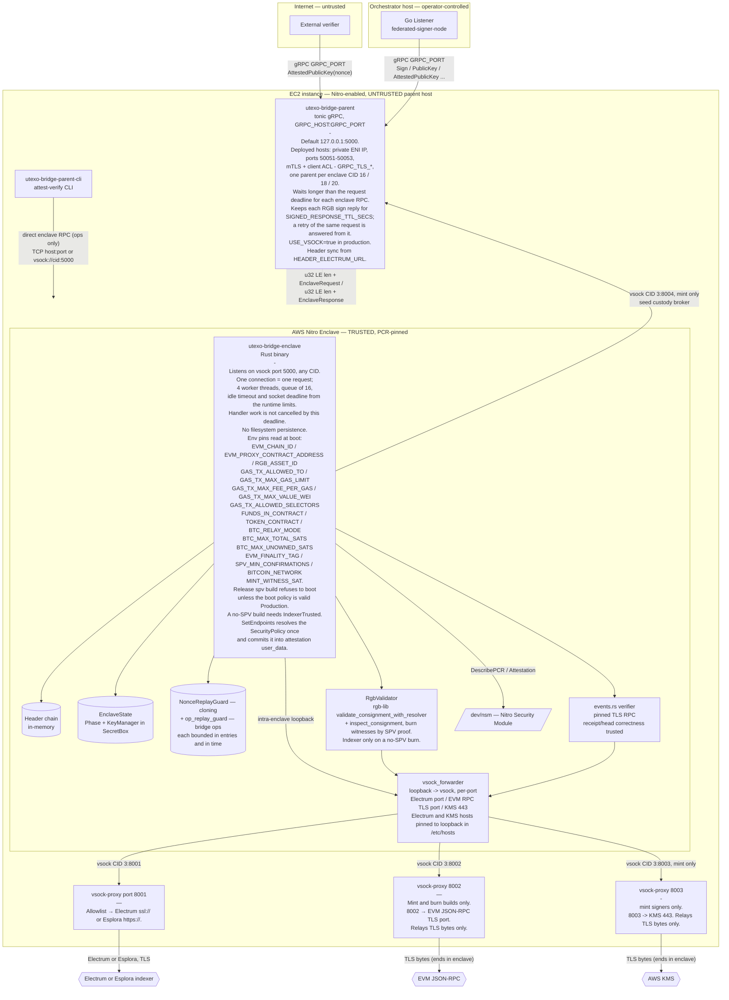

# UTEXO Bridge Enclave-Signer — Deployment

### Notes

- The image is an EIF. Its build reports PCR0, PCR1 and PCR2, and a verifier
  pins the approved values ([building.md](../building.md)).
- The enclave gets its endpoints once after launch and signs nothing before
  that. Members run one image with their own endpoints
  ([configuration.md](../configuration.md#launch-values)).
- A deploy installs only the units, control scripts, launch file and
  artifacts of its CID. The other enclaves of the host can run other roles
  and PCRs ([operations.md](../operations.md#deploy-hostsh)).
- Keys live in enclave memory only. A mint signer recovers its seed through
  [KMS](../kms-persistence.md). A burn signer [clones](../cloning.md) it.
  Clones are replicas of one signing identity; independent quorum members
  need independently made seeds.
- [operations.md](../operations.md) has the launch steps and the checks.
