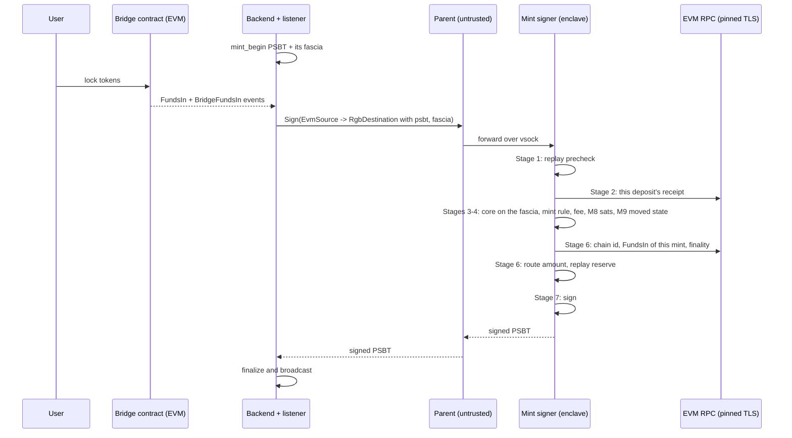

# Mint flow (EVM -> RGB)

- **Signer image:** `mint-signer`
  (`--no-default-features --features vsock,mint-signer`).
- **Checked against repository code:** 2026-11-10, rgb-lib-bfa 5010eefa
  (RGB-Tools bfa 66bae096). Deployment was not checked.

This document gives the checks of the mint signer, in order. The
[specification](tee-spec.md) gives the trust model and the known limits. If
the code and this document differ, investigate the difference. Either can
contain an error.

## 1. What the mint flow does

1. The backend makes an RGB mint (a BFA `mint` transition) with rgb-lib's
   `mint_begin`, and a Bitcoin PSBT that anchors it. It gets the mint's lockId
   and `settlementData`: `abi.encode(uint256 lockId, uint64 beforeBlock)` and
   then one fee-type byte (0 = BASE, 1 = WITNESS), 65 bytes. The mint commits
   to `beforeBlock`: its EVM lock must be in an earlier (L2) block.
2. The user locks ERC-20 tokens in the Bridge contract on EVM. The `fundsIn`
   call carries that `settlementData`.
3. The Bridge contract writes a `FundsIn` event and a `BridgeFundsIn` event.
   `FundsIn` names the mint's lockId.
4. The backend sends the PSBT and the fascia that rgb-lib wrote for the mint
   transaction.
5. The mint signer checks the deposit, the mint, the PSBT and the fascia.
6. The mint signer signs the PSBT with its colored Taproot key.
7. The backend finalizes and broadcasts the Bitcoin transaction.
8. The recipient validates the RGB transfer and waits for the required
   confirmations.

### The lockId

`LockId(opid, txid)` commits a mint to its exact Bitcoin transaction. It is
`SHA256(t || t || opid || txid)` with
`t = SHA256("urn:lnp-bp:rgb:lock#2026-11-04")`. Each id is its 32 bytes, and
the txid is in internal byte order. On EVM the 32 bytes are one big-endian
`uint256`.

Test vector: opid bytes 0x00 to 0x1f and txid bytes 0x20 to 0x3f give
`1ce683c92fdfb3ef54e39c7b461e731dad02cd240b366441f34a2c2e849a9876`.

### The mint transaction cannot change after the lock

The lockId commits the txid. So after the lock there is no RBF, no rebuild
and no batching, and a retry signs the same PSBT. Another transaction for the
same mint names another lock, which M6 refuses.

The fee stays the one that `mint_begin` set. Only a CPFP child that spends an
output of the mint transaction could raise it, and none is implemented: the
bridge rebroadcasts a stuck mint transaction as it is. So the operator must
plan for the transaction to confirm at its original fee. The user output of a
witness mint is the seal that holds the minted units. A child that spends it
without a valid RGB transition destroys the units.

## 2. Who does what

| Part | Where | Trusted for | Job |
|------|-------|-------------|-----|
| User | EVM | - | Locks tokens. |
| Bridge contract | EVM | Deposit records | Holds the tokens. Writes the deposit events. |
| Backend and listener | Operator servers | Nothing | Build the PSBT and its fascia. Send the request. |
| Parent | EC2 host | Nothing | Moves bytes. Relays KMS and S3 traffic for the seed. |
| Mint signer | Nitro Enclave | Checks and keys | Checks the deposit and the mint. Signs the PSBT. |
| EVM RPC | Pinned TLS host | Receipts, canonical blocks and the selected finality head | Gives the deposit receipts and the data for the finality and block-hash checks. |

The mint signer ignores the `event_valid` and `event_finalized` flags of the
listener. It checks the deposit itself through the pinned EVM RPC. It trusts
that provider for receipts, canonical blocks and the selected finality head.
It does not verify EVM consensus.

**A deposit that is not final yet.** If the receipt is above the `safe` or
`finalized` head, the enclave refuses with error code 8. The parent turns
that code into `FailedPrecondition` with the fixed prefix
`evm event pending finality:`. The bridge treats it as a wait and retries.
Other validation failures have code 3.

**No consignment.** rgb-lib commits the PSBT and then strips its RGB keys. It
keeps the RGB data in the fascia of the transaction: the unsigned
transaction, every bundle that the transaction commits and the MPC block with
its entropy, strict-encoded. The mint signer reads the mint from that fascia
and validates no RGB history. [Section 11](#11-the-main-idea) says why that
is enough.

The mint image carries `SPV_MIN_CONFIRMATIONS` in its attested policy, but no
mint check reads it. The connector should still mint only on a right whose
send is that deep: if that send leaves the chain, the mint is invalid until
the send is mined again.

## 3. Sequence

The RGB fields of a mint and a refill on each hop. The fascia is the
strict-encoded file that rgb-lib writes, sent as raw bytes. The last column
gives reserved field numbers; do not reuse them. A request with a value at
one of them and no fascia fails F4.

| Hop | Message | PSBT | Fascia | Reserved |
|-----|---------|------|--------|----------|
| Bridge to listener | `node.RgbSignData` | `psbt` 3 | `fascia` 6 | 5, 7 |
| Listener to parent | `parent.EnrichedRgbPayload` | `psbt_bytes` 2 | `fascia` 9 | 8, 10 |
| Parent to enclave, mint | `enclave.RgbDestination` | `psbt_bytes` 2 | `fascia` 9 | 8, 10 |
| Parent to enclave, refill | `enclave.SignRightsRefillRequest` | `psbt_bytes` 1 | `fascia` 6 | 5, 7 |

## 4. Key values

| Name | Value | Meaning |
|------|-------|---------|
| `TS_MINT` | 8013 | Mint transition. A mint commits exactly one, and beside it only side transitions (F6). |
| `TS_PROPAGATE` | 8014 | Moves one mint right to new rights. The only transition a refill may commit (RR6). |
| `TS_TRANSFER`, `TS_TRANSFER_INFLATION`, `TS_TRANSFER_LINK` | 10000, 8015, 8016 | With `TS_PROPAGATE`, the types a side transition may have: they move state on (F6). |
| `MAX_FASCIA_BUNDLES` | 16 | Most contract bundles in a fascia (F4). |
| `OS_ASSET` | 4000 | Output that holds RGB units (u64). |
| `OS_MINT` | 4013 | The mint right (`mintRight`). It holds no units. |
| `GS_ISSUED_SUPPLY` | 2010 | Mint global: the units it issues. |
| `MS_BEFORE_BLOCK` | 1003 | Mint metadata: the lock must be in an earlier EVM (L2) block. |
| `RGB_CHAIN_ID` | 827166 | The bridge's id for the RGB network. Compiled in. |
| `MINT_INPUTS` | 1 | Inputs of a mint (F7). |
| `MAX_FEE_RATE_SAT_VB` | 200 | Maximum fee rate, over the unsigned size. |
| `MAX_FEE_SATS` | 100,000 | Maximum fee. |
| `MIN_FEE_RATE_SAT_VB` | 1 | Minimum fee rate, over the estimated signed size. |
| MPC tree depth | 3 | The depth that rgb-lib commits with, and rebuilds the tree at in F5. |
| Colored account | `m/86'/827166'/0'` on mainnet | The only account that signs a mint. |
| Amount rule | `OS_ASSET == issuedSupply == amount - commission` | Exact. Not a minimum. |

`EVM_FINALITY_TAG`, `SPV_MIN_CONFIRMATIONS` and `MINT_WITNESS_SAT` are image
settings ([configuration.md](configuration.md)). The size limits and the
replay window named below are runtime limits
([runtime-limits.md](runtime-limits.md)).

## 5. Checks, in order

If one check fails, the mint signer stops. It signs nothing. It returns an
error.

The stages group the checks by topic. The code order differs in places: F1
runs before M0, and F7 and the fee check run after M1 - M5 and M7, then M8
and M9. Section 3
and [diagram 04](diagrams/04-seq-sign-psbt.md) show the code order. The
stage number 5 is not used: the mint signer does not read the transaction
that made the spent right.

### Stage 0 - Can this enclave do this request?

- **S0.1** The launch values must be set (`SetEndpoints`).
- **S0.2** The source must be EVM and the destination must be RGB. The mint
  signer refuses a burn request.
- **S0.3** The key must be ready (the enclave is `Active`). Otherwise the
  signer refuses with `KeyNotInitialized`, before the replay check and any
  network call.

### Stage 1 - Is this a repeat?

- **S1.1** The mint signer makes a replay key from `chain_id`, the proxy
  contract, `evm_tx_hash`, `funds_in_operation_id` and the asset id.
- **S1.2** If the replay guard still holds this key, the signer refuses the
  request. This check records nothing. It runs before any network call. A
  retry of the same request normally does not reach the enclave: the parent
  answers it from the reply that it kept (S7.6).

### Stage 2 - Is this deposit real?

The mint signer gets the receipt itself, through TLS to the pinned EVM RPC
host. TLS ends inside the enclave. Each call has the timeout
`evm_rpc_timeout_secs`.

- **S2.1** `evm_tx_hash` and `funds_in_operation_id` must each be 32 bytes.
- **S2.2** The receipt must exist and must be a success.
- **S2.3** The receipt must have exactly one `BridgeFundsIn` event from the
  pinned `FUNDS_IN_CONTRACT` whose `operationId` (topic 1) is the request's
  `funds_in_operation_id`. Zero or two such events: refuse. Other deposits in
  the transaction are ignored. There is no fallback to the plain `FundsIn`
  event, which carries a lockId, another id space.
- **S2.4** All 32 bytes of the event `operationId` must equal the request's
  `funds_in_operation_id`.
- **S2.5** The event `amount` must equal the request amount. The event
  `tokenCommission` must equal the request commission.
- **S2.6** `netAmount` must not be more than `amount - commission`.
- **S2.7** Each amount must fit in a u64. The mint signer does not cut a
  larger value. It refuses it.
- **S2.8** The head that `EVM_FINALITY_TAG` selects must cover the receipt,
  and the receipt's `blockHash` must match the canonical block at its height.
  The enclave reads the head again afterwards to detect a reorg. A receipt
  above the head, or missing tag data, refuses signing. A pending deposit can
  be retried once the head covers it.

### Stage 3 - Does the PSBT commit exactly one mint, and only moves beside it?

The core. It reads the RGB data from the request's `fascia`, never from the
PSBT: RGB keys left in a PSBT are ignored. rgb-lib's wallet-less fascia
inspection (`inspect_fascia`) proves the commitments of F5 and F6; the rules
around it are the enclave's.

- **M0** The mint transaction has at most `mint_max_inputs` inputs and
  `mint_max_outputs` outputs. The enclave checks this before it decodes a
  fascia.
- **F1** The PSBT must parse and have at least one input.
- **F2** Each input must have a `witness_utxo` with a native witness
  program, so the unsigned txid is the final txid. Each sighash type must be
  `SIGHASH_ALL` or Taproot `DEFAULT`.
- **F3** The first output that is an `OP_RETURN` or a P2TR must be an
  `OP_RETURN`. RGB consensus reads the commitment from that output. A P2TR
  first would make it a tapret host that the opret check never sees. P2A is
  not P2TR. rgb-lib verifies the commitment with the DBC proof that the
  fascia carries, so the inspection must report the opret close method: a
  tapret proof commits in a P2TR output, which this rule does not read.
- **F4** `fascia` must not be empty and must decode as rgb-lib reads its
  fascia file: strict encoding, nothing after it, at most `max_psbt_bytes`.
  Its witness txid must be the PSBT's unsigned txid, which rgb-lib's
  inspection binds. It discloses at most 16 bundles (`MAX_FASCIA_BUNDLES`),
  one of them of the contract that `RGB_ASSET_ID` names. The request's
  `asset_id` must name that contract too. A bundle of another contract is
  allowed: rgb-lib moves the state of every asset on the UTXO that it
  spends, each asset in its own bundle.
- **F5** The MPC tree of every bundle that the fascia discloses, under the
  entropy that the fascia carries, must give the 34-byte `OP_RETURN`
  commitment. The enclave passes no entropy of its own, so rgb-lib takes the
  one the fascia's MPC commitment carries, and refuses a concealed commitment
  that carries none. So the fascia shows exactly the bundles that the
  transaction commits: a hidden, extra or swapped bundle changes the
  commitment.
- **F6** The pinned contract's bundle holds exactly one main transition: the
  one `TS_MINT` of a mint, the one `TS_PROPAGATE` of a refill. Every other
  transition of the transaction, in that bundle or in another contract's, is
  a **side transition**. rgb-lib builds one for each other allocation of the
  UTXO that it spends, to move that state to its change.
  - A side transition must be of a type that only moves state on:
    `TS_TRANSFER`, `TS_PROPAGATE`, `TS_TRANSFER_INFLATION` or
    `TS_TRANSFER_LINK`. A second mint, a burn, an inflation or a link is
    refused.
  - Every seal that a side transition assigns must be a witness seal: an
    output of this transaction. A blinded seal or an output of another
    transaction is refused, as the enclave cannot see who holds it. M9 then
    proves each of those outputs the enclave's own. A refill takes no side
    transition (RR3).
  - Every transition is stored under its own id, which rgb-lib recomputes,
    and belongs to the contract of its bundle. In each bundle the input map
    must close exactly the inputs of the disclosed transitions: rgb-lib binds
    each input of a transition to its id, and the inspected counts of
    transitions and of closed seals in the map must equal the enclave's own
    count from the same bytes. So no map names a transition that the fascia
    hides.
  - The two readings must name the same transaction, the same contracts and
    the same transitions.

  The enclave does not see what state a side transition spends, so it does
  not check that the state it assigns is all of it.
  The inspection also decodes every global and metadata entry of each
  transition, so one that no schema defines, or a value of the wrong length,
  is refused here, before M4 reads it.
- **F7** The PSBT spends exactly one input (`MINT_INPUTS`), a Colored
  key-path input of the enclave. So the UTXO of the right must pay the fee
  and, for a witness mint, `MINT_WITNESS_SAT`. If that UTXO is too small for
  the fee rate, rgb-lib adds a second input and F7 refuses the mint. The
  bridge must refuse such a mint before `mint_begin`.
- **Fee**:
  - not more than `MAX_FEE_SATS`;
  - not more than `MAX_FEE_RATE_SAT_VB` over the unsigned size, which the
    host cannot pad;
  - not less than `MIN_FEE_RATE_SAT_VB` over the estimated signed size;
  - if the enclave cannot estimate the size of an input, it refuses.

The mint signer takes no fee estimate from outside. A changing estimate could
block a mint after its deposit is final. The bridge must check the market fee
before the user locks tokens. The fee limits are compiled in, so a change
needs a new image.

### Stage 4 - Is it a mint of exactly the deposit?

- **M1** The main transition is the pinned bundle's one `TS_MINT` (F6).
- **M2** It must close exactly one input, an `OS_MINT`.
- **M3** It assigns `OS_ASSET` only. It passes no `mintRight` on (a mint uses
  up its right) and makes no link.
- **M4** Its globals are exactly `issuedSupply`: one value of 8 bytes, a
  little-endian u64 above 0. Its metadata is exactly `beforeBlock`: 8 bytes,
  a little-endian u64.
- **M5** The `OS_ASSET` units must equal `issuedSupply`, and **exactly**
  `amount - commission`. A larger sum is an over-mint.
- **M7** There is exactly one `OS_ASSET` leg: on a blinded seal (the
  depositor's), or on a witness seal that is an output of this transaction (a
  witness invoice). A seal on an output of another transaction is refused:
  the enclave cannot see what that output pays.
- **M8** The sats that the mint pays out. It runs on the PSBT after the fee
  check, and before M6 reads the deposit.
  - A blinded mint pays no sat out. Every output is the enclave's own
    ([section 7](#7-plain-btc-signbtc)), or carries 0 sat, as the `OP_RETURN`
    must.
  - A witness mint pays exactly `MINT_WITNESS_SAT` to the output of its seal.
    That output must exist, must not be an `OP_RETURN`, and must not be the
    enclave's own. The host builds the PSBT and its output metadata, so the
    enclave also refuses an output on the script of an input that it can
    sign: that comparison needs no metadata, and it matches an input on a
    script with a tree too. Every other output is the enclave's own, or
    carries 0 sat. The change may be missing.
  - The connector and the enclave must use the same `MINT_WITNESS_SAT`. The
    PSBT pays the connector's value, fixed at `mint_begin`, and a mismatch is
    refused here, after the user's lock. The attestation does not carry the
    value, so the deploy must compare the two before a release takes witness
    invoices.
- **M9** State that a side transition moves stays in the wallet. Each output
  that a side transition assigns state to (F6) must be a key-path output
  that the enclave derives on the Colored account, at child path `[0, i]`,
  the keychain rgb-lib scans, and must carry sats. So it is never the
  `OP_RETURN`, a 0-sat output, a Vanilla output or the output of a witness
  recipient. It runs with M8.

### Stage 6 - Is the deposit this mint's, and the user the right one?

- **M6** The deposit must name this mint and this transaction:
  - The EVM node must report `EVM_CHAIN_ID`. `TOKEN_CONTRACT` and
    `EVM_CHAIN_ID` must be pinned, which the enclave checks before the RPC
    calls of M6.
  - The receipt of `evm_tx_hash` must have exactly one `FundsIn` event from
    `FUNDS_IN_CONTRACT` whose `lockId` is `LockId(opid, txid)` of this mint
    and the PSBT's transaction, with `issuedSupply` as its amount.
  - It must have exactly one `BridgeFundsIn` event whose `operationId` is the
    deposit id that the mint derives from its lockId and `issuedSupply`
    ([burn-flow.md](burn-flow.md), B2.4). That id must be the request's
    `funds_in_operation_id`, which S2.3 bound. Its `netAmount` must equal
    `issuedSupply`. Other deposits in the transaction are ignored.
  - `destinationChainId` must be `RGB_CHAIN_ID`.
  - `destinationAddress` must be empty. The Bridge refuses an RGB deposit
    that names an address, and no check binds a mint to one.
  - The receipt block must be before `beforeBlock`, at or below the head
    that `EVM_FINALITY_TAG` selects, and its `blockHash` must match the
    canonical block at its height. The enclave reads the head again
    afterwards to detect a reorg. A receiving rgb-lib wallet confirms the
    mint only once the lock is `finalized`.
- **S6.1** The amount must cover the minted units plus the commission. The
  enclave takes the minted amount from the fascia.
- **S6.3** The deposit binds the user through the mint's lockId (M6). The
  mint transition commits to its seal, and the transaction to the script on
  the output of a witness seal (section 11).
- **S6.4** The mint signer reserves the replay key.

The rule number S6.2 is not used: a deposit carries no invoice, so no invoice
check runs on it.

### Stage 7 - Sign

- **S7.1** There is no unowned-sats budget. M8 is the only sats gate.
- **S7.2** The mint signer signs only inputs of the colored account. It uses
  Taproot key-path signatures with BIP-86 account keys. A Tapret or
  script-tree root can be part of the tweak. It never makes a script-path
  signature.
- **S7.3** For each input, the derived key must equal the internal key, and
  the tweak must give the output key. A false origin claim fails here.
- **S7.4** Zero signed inputs is an error.
- **S7.5** The response is `SignedPsbtResponse { signed_psbt, inputs_signed }`.
  The PSBT is not finalized.
- **S7.6** The enclave commits the replay key only after it wrote the
  response. A failed write releases the key. A successful write does not
  prove that the caller received the response. So the parent keeps the reply
  of an EVM -> RGB sign for `SIGNED_RESPONSE_TTL_SECS` and answers a retry of
  the same request itself. A retry of a request still in flight waits for
  that exchange and gets its reply. A retry of a request that the enclave
  already signed reaches the enclave only when the parent has no reply for
  it: the parent did not read the reply, the reply was above
  `SIGNED_RESPONSE_MAX_BYTES`, the parent dropped it at
  `SIGNED_RESPONSE_MAX_ENTRIES` or `SIGNED_RESPONSE_MAX_BYTES`, the reply is
  older than `SIGNED_RESPONSE_TTL_SECS`, or the parent restarted. The enclave
  refuses that retry while its replay guard holds the key (section 6).

## 6. Replay

The replay guard is in memory and per enclave. It does not survive a restart,
and replicas do not share it. It holds a key for `mint_replay_ttl_secs`, and
`mint_replay_max_entries` can remove the oldest keys earlier. The parent
keeps each reply and answers a retry of the same request from it, so a lost
response does not strand a deposit for the window.

The guard is not the safety control. M6 is: the deposit names one lockId,
and the lockId commits the mint's OpId and txid. So every signature for one
deposit is for the same transaction, and Bitcoin confirms it at most once.
The same transition in another transaction, or another transition, names
another lockId, which M6 refuses.

## 7. Plain BTC (`SignBtc`)

The mint signer also signs plain Bitcoin PSBTs, for example to make UTXOs. It
is a request of its own: a `Sign` request cannot reach this path.

- On a `Production` policy the attested policy must allow it
  (`allow_vanilla_psbt`), which needs a non-zero `BTC_MAX_TOTAL_SATS`. On any
  other policy the enclave still refuses every request while
  `BTC_MAX_TOTAL_SATS` is 0.
- Only the vanilla account signs. A colored input is never signed here.
- The total input value must not be more than `BTC_MAX_TOTAL_SATS`.
- No sat leaves the wallet. Every output is the enclave's own, or carries
  0 sat.
- The fee limits of Stage 3 apply. An input whose size the enclave cannot
  estimate refuses the request.

The enclave derives ownership from its keys. There is no configured list of
scripts. An output is the enclave's own when it is a BIP-86 key-path output
of an enclave account, with no script tree, at a wallet path `[k, i]`: both
steps non-hardened, `k` = 0 on the colored account and 0 or 1 on the vanilla
account. The PSBT output must carry the internal key and its key origin. The
enclave derives the key at that path and rebuilds the script. An output
without this data, and an enclave key at any other path, count as not owned.
So does an output on the script of a spent input: the wallet pays to a new
address each time, and its outputs carry this data.

An enclave key in one Taproot leaf proves nothing about the rest of the
tree, so no rule accepts it.

There is no rate limit. Each limit bounds one request, and the change goes
back to a vanilla output that the host can submit again. So a compromised
host can turn the whole vanilla balance into fees, at most `MAX_FEE_SATS`
per signature. It cannot pay an address outside the wallet. The bound on the
sum belongs outside the enclave.

## 8. Rights refill (`SignRightsRefill`)

A mint uses up its right, so the connector refills its pool itself. It sends
one of its own rights to K of its own witness invoices, with K from
`MIN_REFILL_RIGHTS` (2) to `MAX_REFILL_RIGHTS` (255). The mint signer signs
that send under a rule of its own. No deposit backs it, so the rule checks
shape only: every new right and every sat stays on the enclave's own outputs,
and no units move.

The parent maps `data_type` `RGB_RIGHTS_REFILL` to `SignRightsRefill`
(`psbt_bytes`, `asset_id`, `fascia`). It refuses a request
with a source proof or without `RgbData`. The reply is `SignedPsbtResponse`.
Like every signing request it waits for `SetEndpoints`, but it reads no
network.

The cheap checks run first.

**Gate** (PSBT and keys only):

- **RR0** The PSBT has 1 or 2 inputs: the right's UTXO and at most one fee
  input (`MAX_REFILL_FEE_INPUTS`). This rule counts the inputs only. Each input
  could destroy the state it carries.
- **RR10** Every input is a Colored key-path input of the enclave (the
  custody check of S7.3).
- **RR12** M8 of a blinded mint: no sat leaves. An output that repays an
  input script gets no exemption here.
- **RR13** The fee limits of Stage 3.
- **RR15** At most `MAX_REFILLS_PER_HOUR` (12) requests in any sliding hour
  get past this point. The count is in memory and per enclave, and a restart
  resets it. A request that the gate refuses does not count. A request
  refused later does.

**From the PSBT and its fascia** (the core of Stage 3):

- **RR5** F2, F3 and F5. F3 matters most here: RR12 admits 0-sat outputs, and
  a 0-sat P2TR before the `OP_RETURN` would switch the commitment method.
- **RR3** F4 and F6: the refill's own fascia, of the pinned asset. A refill
  commits its propagate only: a side transition is refused, so the UTXO of
  its right, and its fee input, must hold no other state.
- **RR6** The one transition is a `TS_PROPAGATE`.
- **RR7** It closes exactly one input, an `OS_MINT`. It assigns `OS_MINT`
  only, each right with no state, and has no globals and no metadata.
- **RR8** It makes 2 to 255 rights. Each is on a witness seal (an output of
  this transaction), never on a blinded seal or an output of another
  transaction, and no two share an output.

**Keys:**

- **RR9** The output of each right is a Colored BIP-86 key-path output of
  the enclave at child path exactly `[0, i]`, both steps non-hardened: the
  keychain that rgb-lib scans. A right on a host key could mint against a
  deposit that the bridge also mints. A right on a Vanilla output is
  invisible to rgb-lib, and `SignBtc` could spend it.
- **RR14** S7.2 - S7.4: the Colored inputs are signed. Zero signed inputs is
  an error.

The rule numbers RR1, RR2 and RR4 are not used: a refill carries no
consignment, so no consignment size, hash, consensus or reject-list check
runs on it. RR11 is not used either: the mint signer does not read the
transaction that made the right.

**Where the fascia comes from.** rgb-lib writes each fascia as the `fascia`
file of the transfer directory. A mint's fascia is that of its mint
transfer. A refill's is the one its send returns. A fascia must be
strict-encoded; F4 refuses a JSON fascia.

What a refill does not check, and why that is safe:

- **No deposit and no replay key.** No units move. The new rights are valid
  only if the transaction spends the UTXO of the right that the transition
  closes, and Bitcoin confirms one spend of that UTXO.
- **Spent state (accepted residual).** The mint signer does not see which
  RGB state an input holds. A hostile host can make it sign a refill whose
  inputs are any Colored UTXOs of the enclave (RR0, RR10). The state on them
  is lost: up to two UTXOs, such as rights, per refill, with fees from the
  enclave's Colored sats. The host cannot take a right: every new right is
  the enclave's (RR9) and every sat stays (RR12). RR15 is an in-memory rate
  per enclave process, not a total: at `MAX_REFILLS_PER_HOUR` the host can
  destroy the rights of a full mint wallet within a day, and faster after a
  relaunch or with a second replica. Minting then stops until the issuer
  sends new rights.
- **Fees.** Each refill signature can burn at most the fee limits of Stage 3
  (RR13). RR15 bounds how many signatures an enclave makes in an hour.

The refill limits are compiled in, so PCR0 measures them.

## 9. What the mint signer refuses

| Request | Result |
|---------|--------|
| `Sign` with an RGB source or an EVM destination (burn) | Refused: wrong signer role. |
| `SignRawDigest` (gas transaction) | Refused: wrong signer role. |
| `InitiateCloning`, `GetClone`, `SetClone` | Refused: the seed comes from KMS. |
| `Sign` without `fascia` | Refused (F4). rgb-lib strips the PSBT, so there is nothing else to read. |
| `SignRightsRefill` without `fascia` | Refused (F4). |
| `SignRightsRefill` that breaks a rule of section 8 | Refused. Past the gate it still counts against the hourly limit. |
| `SignRawMessage` | Refused in every build. |

## 10. Seed

The mint signer gets its seed from AWS KMS. The encrypted seed is in S3. Mint
replicas recover the same seed. See [KMS seed persistence](kms-persistence.md).

## 11. The main idea

A mint spends one mint right (`OS_MINT`, no units) and makes units
(`OS_ASSET`). It passes no right on, so each mint uses up a right.

**The txid fixes what the mint does.** Each step from the signed txid to the
transition is a commitment:

1. The signature commits to the unsigned transaction. Native SegWit inputs
   keep the txid fixed (F2).
2. The fascia is of that transaction: its witness txid is the PSBT's txid
   (F4).
3. The first `OP_RETURN` or P2TR output is an `OP_RETURN` (F3), and the
   fascia commits with the opret method. RGB consensus reads the commitment
   from that output.
4. rgb-lib rebuilds the MPC tree from every bundle that the fascia discloses
   and checks it against that `OP_RETURN` (F5).
5. Each bundle id commits its input map. Each entry must name a disclosed
   transition, whose id rgb-lib recomputes (F6).

**The amount is checked three times**, from the fascia and the deposit:

1. The mint rule: the one `OS_ASSET` leg equals `issuedSupply` (M5).
2. The deposit: its `FundsIn` names this mint's lockId, and the deposit id
   that the mint derives carries `issuedSupply` (M6). The units equal
   `amount - commission` (M5).
3. The recipient: the deposit's lockId binds the one leg (M7) and its
   transaction (S6.3).

**History decides whether a mint takes effect, never what it does.** A
receiver validates the full history when it accepts the mint, so a bad
history makes the mint invalid for everyone. It moves no other state out of
the wallet and inflates nothing. So the enclave checks no history, and each
missing check is a liveness limit only:

- No consensus over the history, and no genesis or schema check. The pinned
  contract id commits the genesis. A genesis `bridgeLocation` that differs
  from the funds-in pin is an operator error: receivers look for the lock on
  the genesis bridge and refuse the mint.
- No ancestor mint check. The burn signer derives each deposit.
- No witness depth. The mint signer checks no witness transaction of the
  history.
- No reject list. The connector's rgb-lib checks it before `mint_begin`.
- No invoice expiry. The deposit carries no invoice, so the enclave reads
  no expiry. It can sign a mint after the user's invoice expired. A wallet
  fails a receive that it has not checked when the invoice expires. The
  connector checks the time left when it prepares the mint
  (`MINT_INVOICE_MIN_TTL`), but slow blocks can still pass the expiry.

A host that controls the bridge can therefore make a mint that no receiver
accepts, after the user locked. It cannot mint units that no deposit backs,
and it cannot move other state out of the wallet: the transaction commits
one mint, and every other transition only moves state to a Colored output of
the enclave (F2 - F6, M9). It can destroy other state. The mint signer does
not see which RGB state the spent UTXO holds, so a mint or a refill can
spend a Colored UTXO that holds other state without moving it, or move less
than it holds, and that state is lost (section 8).

**A witness mint's output script is bound by the lockId.** A witness seal
names an output number of the mint transaction, and the OpId commits that
number, not the script on it. The lockId that the deposit names also commits
the mint txid. So the same mint in a transaction that pays another script
names another lock, and M6 refuses it. The user still locks the lockId that
the bridge hands out, so the bridge must name the transaction that pays the
user. M8 keeps the units off the enclave's own outputs and bounds the sats
that leave to `MINT_WITNESS_SAT`.

**The receiving wallet can still refuse a mint.** rgb-lib's receive also
checks limits on the receiver's own wallet state: the allocations on the
receiving UTXO, and the total amount of the asset. The enclave cannot see
that state. rgb-lib runs these checks when it first processes the mint and
again when the lock is final. A refusal fails the receive for good, while
the connector still signs, broadcasts and completes the mint. After the lock
this is more than a liveness limit: the user loses the mint. The units sit
on a seal that the wallet does not track, the deposit stays in the Bridge
with no refund, and it cannot back another mint, because the lockId commits
this one. Before the lock a refusal costs nothing. So a caller should lock
only once the wallet reports the mint with the returned lockId
(`ReceivedMint.lock_id`). A witness
mint pays a new output, which starts with no allocations, so these limits
apply mainly to blinded mints.

The fascia is read in the strict encoding of the pinned `rgb-ops`. A change
of that encoding fails F4: every mint and refill is refused until the
enclave moves with rgb-lib.
