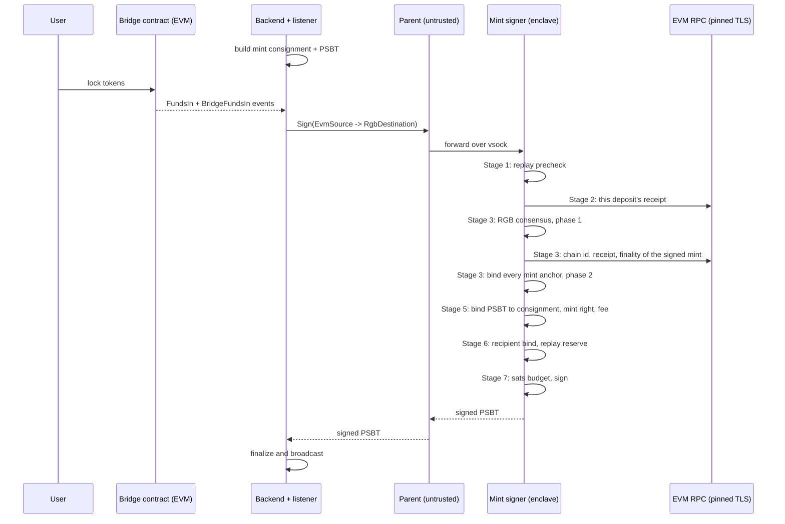

# Mint flow (EVM -> RGB)

**Signer image:** `mint-signer` (`--no-default-features --features vsock,rgb,mint-signer`).
**Checked against repository code:** 2026-10-12 (RGB 0.11.2-rc.1 port).
Deployment was not checked.

This document tells how the mint signer checks and signs a mint. The
[spec](tee-spec.md) describes the rules and known limits. If the code and this
document differ, investigate the difference. Either can contain an error.

## 1. What the mint flow does

1. The user locks ERC-20 tokens in the Bridge contract on EVM.
2. The Bridge contract writes a `FundsIn` event and a `BridgeFundsIn` event.
3. The backend makes an RGB mint (a BFA `mint` transition) and a Bitcoin
   PSBT that anchors it. The mint commits to `afterBlock`: the EVM
   finalized block when it was made.
4. The mint signer checks the deposit, the mint and the PSBT.
5. The mint signer signs the PSBT with its colored taproot key.
6. The backend finalizes and broadcasts the Bitcoin transaction.
7. The recipient validates the RGB transfer and waits for the required confirmations.

## 2. Who does what

| Part | Where | Trusted for | Job |
|------|-------|-------------|-----|
| User | EVM | - | Locks tokens. |
| Bridge contract | EVM | Deposit records | Holds the tokens. Writes the deposit events. |
| Backend and listener | Operator servers | Nothing | Build the consignment and the PSBT. Send the request. |
| Parent | EC2 host | Nothing | Moves bytes. Relays KMS and S3 traffic for the seed. |
| Mint signer | Nitro Enclave | Checks and keys | Checks the deposit and the mint. Signs the PSBT. |
| EVM RPC | Pinned TLS host | Receipt and chain-head data | Gives the deposit receipts. |
| Electrum | Through vsock proxy | Bitcoin data, subject to the checks below | Supplies the transaction of an off-PSBT change outpoint. |

The mint signer ignores `event_valid` and `event_finalized` from the listener.
It checks deposits through the pinned EVM RPC. It trusts that provider for
receipt, chain-head and finality data. It does not verify EVM consensus. It
checks that the node reports the pinned chain id.

The mint path does not verify witness inclusion against the enclave SPV chain.
A V1 consignment carries every witness transaction, and RGB validation reads
them from it as unconfirmed. The PSBT check binds the new transaction to the
consignment before that transaction is mined. Ancestor mints are bound to the
deposits they derive, not read on chain (see section 10).

## 3. Sequence

## 4. Key values

| Name | Value | Meaning |
|------|-------|---------|
| `TS_MINT` | 8013 | Mint transition. The only transition the mint signer accepts. |
| `MS_AFTER_BLOCK` | 1003 | Mint metadata: the lock must be in a later EVM block. |
| `GS_ISSUED_SUPPLY` | 2010 | Mint global: the units it issues. Consensus makes it equal the `OS_ASSET` outputs. |
| `OS_ASSET` | 4000 | Output that holds RGB units (u64). |
| `OS_MINT` | 4013 | The mint right (`mintRight`). Declarative: it holds no units. |
| `EVM_MIN_CONFIRMATIONS` | 12 (default) | Minimum depth of each deposit receipt. Attested. Production refuses 0. |
| `RGB_CHAIN_ID` | 827166 | The bridge's id for the RGB network. Compiled in. |
| `MAX_CONSIGNMENT_BYTES` | 12 MiB (default) | Maximum consignment size. |
| `MAX_OFF_TX_CHANGE_OUTPOINTS` | 4 | Maximum change outpoints outside the PSBT. |
| `MAX_FEE_RATE_SAT_VB` | 200 | Maximum fee rate, over the unsigned size. |
| `MAX_FEE_SATS` | 100 000 | Maximum fee. |
| `MIN_FEE_RATE_SAT_VB` | 1 | Minimum fee rate, over the estimated signed size. |
| `RGB_MAX_UNOWNED_SATS` | not set in the mint image | Maximum sats that go to scripts the enclave does not own. Not set: refuse every mint PSBT. |
| Replay window | 24 h, 100 000 entries | In memory, per enclave. |
| Colored account | `m/86'/827166'/0'` (mainnet) | The only account that signs a mint. |
| Amount rule | `sum(OS_ASSET) == amount - commission` | Exact. Not a minimum. |

## 5. Checks, in order

If one check fails, the mint signer stops. It signs nothing. It returns an
error.

### Stage 0 - Can this enclave do this request?

- **M0.1** The endpoints must be set (`SetEndpoints`).
- **M0.2** The source must be EVM and the destination must be RGB. The mint
  signer refuses a burn request.

The enclave must be `Active`, but no check runs here. The first check that
reads the keys (Stage 5) refuses an enclave without keys.

### Stage 1 - Is this a repeat?

- **M1.1** The mint signer makes a replay key from `chain_id`, the proxy
  contract, `evm_tx_hash`, `funds_in_operation_id` and the asset id.
- **M1.2** If the replay cache still holds this key, the signer refuses it.
  Entries expire after 24 hours. Capacity pressure can remove them earlier.
  This check records nothing. It runs before any network call.

### Stage 2 - Is this deposit real?

The mint signer gets the receipt itself, through TLS to the pinned EVM RPC
host. TLS ends inside the enclave. Each call has a 15 s timeout.

- **M2.1** `evm_tx_hash` and `funds_in_operation_id` must each be 32 bytes.
- **M2.2** The receipt must exist and must be a success.
- **M2.3** The receipt must have exactly one `BridgeFundsIn` event from the
  pinned `FUNDS_IN_CONTRACT`. Zero or two events: refuse.
- **M2.4** The event `operationId` (topic 1) must equal the request's
  `funds_in_operation_id`. All 32 bytes must match.
- **M2.5** The event `amount` must equal the request amount. The event
  `tokenCommission` must equal the request commission.
- **M2.6** `netAmount` must not be more than `amount - commission`.
- **M2.7** Each amount must fit in a u64. The mint signer does not cut a
  larger value. It refuses it.
- **M2.8** The receipt must be at least `EVM_MIN_CONFIRMATIONS` blocks deep. A
  receipt above the chain head (a reorg) is refused.

### Stage 3 - Is the RGB history valid, and is each mint backed?

- **M3.1** The consignment must not be empty. It must not be larger than
  `MAX_CONSIGNMENT_BYTES`.
- **M3.2** `keccak256(consignment)` must equal `consignment_hash`. This check
  finds a damaged copy only. It is not a safety proof.
- **M3.3** The bytes must be a V1 transfer file (`TFR`). A validated copy, a
  contract and a V0 file are refused. The genesis schema must be BFA, and the
  genesis must not declare a reject list (the enclave does not enforce one).
- **M3.4** RGB consensus phase 1 runs under the BFA rules from `rgb-schemas`.
  Nothing in the consignment can change those rules. Each mint leaves an
  anchor: its OpId, its `issuedSupply` and its `afterBlock`.
- **M3.5** The genesis `bridgeLocation` must name the pinned
  `FUNDS_IN_CONTRACT` on the pinned `EVM_CHAIN_ID`. This runs before any RPC.
- **M3.6** Each anchor gets the deposit id it derives
  (`rgb_mint_deposit_id`, see burn-flow B2.3).
- **M3.7** The last bundle must hold exactly one anchor: the mint this request
  pays.
- **M3.8** The EVM node must report `EVM_CHAIN_ID` (`eth_chainId`).
- **M3.9** The receipt of `evm_tx_hash` must have exactly one `FundsIn` event
  with that mint's OpId, and exactly one `BridgeFundsIn` event, both from
  `FUNDS_IN_CONTRACT`. The `FundsIn` amount, the `operationId` and the net
  amount must be the ones the mint derives. Another deposit for the same OpId
  is refused. `destinationChainId` must be 827166 (`RGB_CHAIN_ID`).
- **M3.10** The receipt block must be after the mint's `afterBlock`, at least
  `EVM_MIN_CONFIRMATIONS` deep, and not above the node's `finalized` block. A
  lock that is not final yet is refused; retry later. These are the rules a
  receiving rgb-lib wallet applies, so a signed mint is one it accepts.
- **M3.11** The bound locks must match the anchors one for one. Consensus
  phase 2 confirms each anchor only against its lock, and only through the
  checked resolver, which compares the chain id with the genesis.
- **M3.12** Every witness resolves from the consignment. Then validation
  finalizes.

### Stage 4 - Is it the pinned asset?

- **M4.1** The contract id must equal the declared `asset_id` and the pinned
  `RGB_ASSET_ID`.

### Stage 5 - Does the PSBT do this mint, and only this mint?

- **M5.1** The PSBT must parse and have at least one input.
- **M5.2** The settling transition must be `TS_MINT`.
- **M5.3** The PSBT txid must equal the last witness txid. So the signature
  can complete this one transaction only.
- **M5.4** Each input must be a SegWit output with a `witness_utxo`. So the
  unsigned txid is the final txid.
- **M5.5** The PSBT inputs must equal the inputs of the witness transaction
  the consignment carries.
- **M5.6** Each sighash type must be `SIGHASH_ALL` or taproot `DEFAULT`.
- **M5.7** The bundle the PSBT commits must hide no transition, and must hold
  exactly one transition: the mint. A second mint could absorb a shortfall
  of the first in the amount bind.
- **M5.8** The `OS_ASSET` outputs must sum to **exactly**
  `amount - commission`. A larger sum is an over-mint.
- **M5.9** Each `OS_ASSET` output is a leg:
  - a blinded seal is a recipient leg;
  - a revealed seal must be owned by the enclave. If not: refuse.
  - The recipient legs must sum to exactly `amount - commission`.
- **M5.10** The mint must pass exactly one `mintRight` on, to a revealed seal
  the enclave owns (on the PSBT, or an existing UTXO checked through the
  indexer). The seal may not be an outpoint the PSBT spends: the tx would
  close it at once. Otherwise the host could drop the right or take it.
- **M5.11** Every colored input the enclave signs must spend a seal the mint
  closes. Spending another colored output would destroy the RGB state on it,
  such as another mint right.
- **M5.12** Fee:
  - not more than 100 000 sats;
  - not more than 200 sat/vB over the unsigned size;
  - not less than 1 sat/vB over the estimated signed size.
  - If the enclave cannot estimate the size of an input, it refuses.

The mint signer does not get a fee estimate from outside. A changing estimate
could block a mint after its deposit is final. The bridge must check the
market fee before the user locks tokens.

### Stage 6 - Does the mint pay the correct user?

- **M6.1** The amount must cover the recipient legs plus the commission.
- **M6.2** If the deposit event has a `destinationAddress`, it is an RGB
  invoice. Only a blinded seal is accepted. The consignment must have exactly
  one blinded leg, and it must equal that seal.
- **M6.3** If the `destinationAddress` is empty (the v2 Bridge), the deposit
  binds the user through the mint OpId (M3.9). The mint transition commits
  to its seals.
- **M6.4** The mint signer reserves the replay key.

### Stage 7 - Sign

- **M7.1** The sats that go to scripts the enclave does not own must not be
  more than `RGB_MAX_UNOWNED_SATS`.
- **M7.2** The mint signer signs only inputs of the colored account. It uses
  Taproot key-path signatures with BIP-86 account keys. A Tapret or script-tree
  root can be part of the tweak. It never produces script-path signatures.
- **M7.3** For each input, the derived key must equal the internal key, and
  the tweak must give the output key. A false origin claim fails here.
- **M7.4** Zero signed inputs is an error.
- **M7.5** The response is `SignedPsbtResponse { signed_psbt, inputs_signed }`.
  The PSBT is not finalized.
- **M7.6** The replay reservation is committed after the response write
  succeeds. A failed write releases it. A successful write does not prove
  that the caller received the response. A retry can therefore be refused.

## 6. Replay

The replay guard is in memory and per enclave. It does not survive a restart.
Other replicas do not share it. Bitcoin stops a double spend of the same
inputs. But the guard alone does not stop a new PSBT for the same deposit
after a restart, cache expiry, capacity eviction, or on a different replica.

## 7. Plain BTC (`SignBtc`)

The mint signer also signs plain Bitcoin PSBTs (for example, to make UTXOs).

- The attested policy must allow it (`allow_vanilla_psbt`). This needs a
  non-zero `BTC_MAX_TOTAL_SATS`.
- Only the vanilla account signs. A colored input is never signed here.
- The total input value must not be more than `BTC_MAX_TOTAL_SATS`.
- Outputs that do not go back to enclave custody must not be more than
  `BTC_MAX_UNOWNED_SATS`.
- The same fee limits apply as in M5.12.
- There is no rate limit. The limits apply to one transaction.

## 8. What the mint signer refuses

| Request | Result |
|---------|--------|
| `Sign` with an RGB source or an EVM destination (burn) | Refused: wrong signer role. |
| `SignRawDigest` (gas transaction) | Refused: wrong signer role. |
| `InitiateCloning`, `GetClone`, `SetClone` | Refused: the seed comes from KMS. |
| `SignRawMessage` | Refused in every build. |

## 9. Seed

The mint signer gets its seed from AWS KMS. The encrypted seed is in S3. Mint
replicas recover the same seed. See [KMS seed persistence](kms-persistence.md).

## 10. The main idea

A mint spends the mint right (`OS_MINT`, no units) and makes units
(`OS_ASSET`). The amount is checked three times:

1. RGB consensus: the mint's `OS_ASSET` outputs equal its `issuedSupply`, and
   its anchor confirms only against a `FundsIn` of exactly that amount, for
   that OpId, finalized and after `afterBlock`.
2. The PSBT bind: the new units equal `amount - commission`.
3. The recipient bind: the units go to the user's seal.

Known limit: the mint path does not prove that the ancestor witnesses are
mined, and it binds ancestor mints to their derived deposits without reading
them. A host that controls the bridge can then build a history that no
receiving wallet accepts, after the user locked. It cannot mint units that no
deposit backs. Never mint outside the TEE flow: a mint the enclave did not
sign makes the later mints of its lineage unacceptable to receivers.
