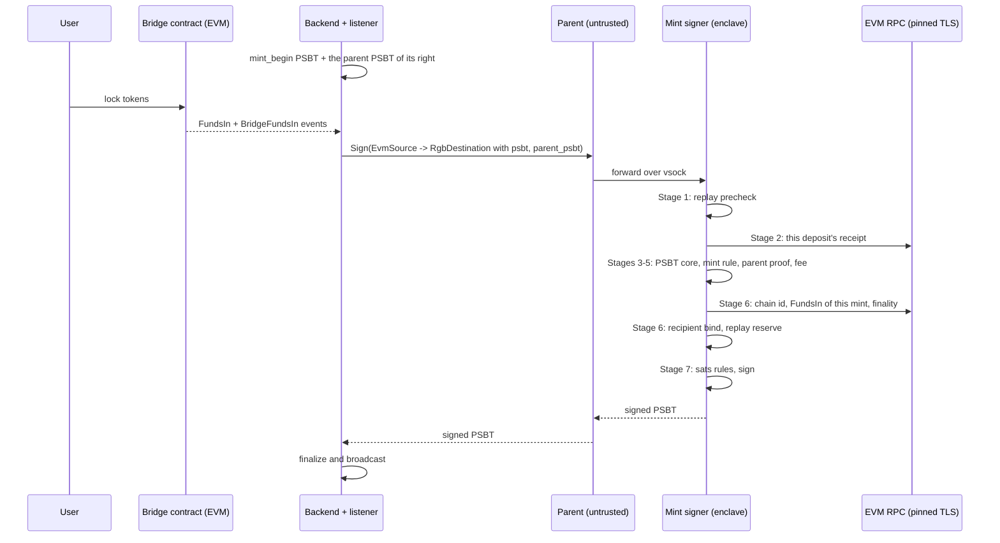

# Mint flow (EVM -> RGB)

**Signer image:** `mint-signer` (`--no-default-features --features vsock,rgb,mint-signer`).
**Checked against repository code:** 2026-10-15 (plan B: the mint signer reads the PSBT).
Deployment was not checked.

This document tells how the mint signer checks and signs a mint. The
[spec](tee-spec.md) describes the rules and known limits. If the code and this
document differ, investigate the difference. Either can contain an error.

## 1. What the mint flow does

1. The user locks ERC-20 tokens in the Bridge contract on EVM.
2. The Bridge contract writes a `FundsIn` event and a `BridgeFundsIn` event.
3. The backend makes an RGB mint (a BFA `mint` transition) and a Bitcoin
   PSBT that anchors it. The mint commits to `afterBlock`: the EVM
   finalized block when it was made. The backend also sends the PSBT of the
   tx that made the right the mint spends (the parent PSBT).
4. The mint signer checks the deposit, the mint and the PSBT.
5. The mint signer signs the PSBT with its colored taproot key.
6. The backend finalizes and broadcasts the Bitcoin transaction.
7. The recipient validates the RGB transfer and waits for the required confirmations.

## 2. Who does what

| Part | Where | Trusted for | Job |
|------|-------|-------------|-----|
| User | EVM | - | Locks tokens. |
| Bridge contract | EVM | Deposit records | Holds the tokens. Writes the deposit events. |
| Backend and listener | Operator servers | Nothing | Build the PSBT. Find the parent PSBT. Send the request. |
| Parent | EC2 host | Nothing | Moves bytes. Relays KMS and S3 traffic for the seed. |
| Mint signer | Nitro Enclave | Checks and keys | Checks the deposit and the mint. Signs the PSBT. |
| EVM RPC | Pinned TLS host | Receipts, canonical blocks and selected finality head | Gives the deposit receipts and the data for the finality and block-hash checks. |
| Bitcoin indexer (Electrum or Esplora) | Pinned URL through the vsock proxy | Nothing | Not read by a mint or a refill. The launch still pins `INDEXER_URL` until the mint image drops the indexer. |

The mint signer ignores `event_valid` and `event_finalized` from the listener.
It checks deposits through the pinned EVM RPC. It trusts that provider for
receipt, canonical block and selected finality head data. It does not verify EVM
consensus. It checks that the node reports the pinned chain id.

The mint signer validates no RGB consignment. It reads the mint from the
PSBT that rgb-lib returns: rgb-lib stores each transition, the input map and
the MPC entropy in the PSBT as proprietary keys. Each step from the signed
txid to the transition is a commitment, so the txid fixes what the mint does:

1. The signature commits to the unsigned tx. Native SegWit inputs keep the
   txid fixed (F2).
2. The first `OP_RETURN` or P2TR output is an `OP_RETURN` (F3). RGB consensus
   reads the commitment from that output.
3. The enclave rebuilds the MPC tree from every bundle the PSBT discloses and
   the entropy, and checks its root against that `OP_RETURN` (F5). A hidden
   bundle changes the root.
4. The bundle id commits the input map. Each entry must name the one
   disclosed transition, whose id the enclave recomputes (F6).

The parent proof (PP1 - PP7) pins the UTXO of the spent right. Every
signature for one mint transition spends that outpoint, so a replay
conflicts with the first (section 6).

History decides whether a mint takes effect, never what it does. A receiver
validates the full history when it accepts the mint, so a bad history makes
the mint invalid for everyone. It moves no other state of ours and inflates
nothing. The enclave checks no history, genesis, ancestor anchor, reject list
or witness depth. Each of these is liveness only (section 11).

The mint image still bakes `SPV_MIN_CONFIRMATIONS` (3) into the attested
policy, but no mint check reads it. The connector should still mint only on a
right whose send is that deep: a mint on a parent that leaves the chain is
invalid until the parent is mined again.

## 3. Sequence

## 4. Key values

| Name | Value | Meaning |
|------|-------|---------|
| `TS_MINT` | 8013 | Mint transition. The only transition the mint signer accepts. |
| `MS_AFTER_BLOCK` | 1003 | Mint metadata: the lock must be in a later EVM block. |
| `GS_ISSUED_SUPPLY` | 2010 | Mint global: the units it issues. It must equal the one `OS_ASSET` output (M5). |
| `OS_ASSET` | 4000 | Output that holds RGB units (u64). |
| `OS_MINT` | 4013 | The mint right (`mintRight`). Declarative: it holds no units. |
| `TS_TRANSFER` | 10000 | The only transition that may make a right a mint spends (PP4). |
| `EVM_FINALITY_TAG` | `safe` (default) | Attested receipt acceptance tag: `latest`, `safe`, or `finalized`. Invalid values reject startup. A production policy also refuses `latest`. |
| `SPV_MIN_CONFIRMATIONS` | 3 (mint image) | Image env, attested. Zero stops the boot. No mint check reads it. |
| `RGB_CHAIN_ID` | 827166 | The bridge's id for the RGB network. Compiled in. |
| MPC tree depth | 3 | The minimum depth rgb-lib commits with. F5 rebuilds the tree at it. |
| `MINT_INPUTS` | 1 | A mint spends its right alone. |
| `MAX_FEE_RATE_SAT_VB` | 200 | Maximum fee rate, over the unsigned size. |
| `MAX_FEE_SATS` | 100 000 | Maximum fee. |
| `MIN_FEE_RATE_SAT_VB` | 1 | Minimum fee rate, over the estimated signed size. |
| `RGB_MAX_UNOWNED_SATS` | not set in the mint image | Second sats gate after M8. Not set: refuse every mint PSBT. |
| Replay window | 24 h, 100 000 entries | In memory, per enclave. |
| Colored account | `m/86'/827166'/0'` (mainnet) | The only account that signs a mint. |
| Amount rule | `OS_ASSET == issuedSupply == amount - commission` | Exact. Not a minimum. |

## 5. Checks, in order

If one check fails, the mint signer stops. It signs nothing. It returns an
error.

### Stage 0 - Can this enclave do this request?

- **S0.1** The endpoints must be set (`SetEndpoints`).
- **S0.2** The source must be EVM and the destination must be RGB. The mint
  signer refuses a burn request.

The enclave must be `Active`, but no check runs here. The first check that
reads the keys refuses an enclave without keys.

### Stage 1 - Is this a repeat?

- **S1.1** The mint signer makes a replay key from `chain_id`, the proxy
  contract, `evm_tx_hash`, `funds_in_operation_id` and the asset id.
- **S1.2** If the replay cache still holds this key, the signer refuses it.
  Entries expire after 24 hours. Capacity pressure can remove them earlier.
  This check records nothing. It runs before any network call.

### Stage 2 - Is this deposit real?

The mint signer gets the receipt itself, through TLS to the pinned EVM RPC
host. TLS ends inside the enclave. Each call has a 15 s timeout.

- **S2.1** `evm_tx_hash` and `funds_in_operation_id` must each be 32 bytes.
- **S2.2** The receipt must exist and must be a success.
- **S2.3** The receipt must have exactly one `BridgeFundsIn` event from the
  pinned `FUNDS_IN_CONTRACT`. Zero or two events: refuse.
- **S2.4** The event `operationId` (topic 1) must equal the request's
  `funds_in_operation_id`. All 32 bytes must match.
- **S2.5** The event `amount` must equal the request amount. The event
  `tokenCommission` must equal the request commission.
- **S2.6** `netAmount` must not be more than `amount - commission`.
- **S2.7** Each amount must fit in a u64. The mint signer does not cut a
  larger value. It refuses it.
- **S2.8** The receipt must be covered by
  `eth_getBlockByNumber(EVM_FINALITY_TAG, false)` and its `blockHash` must match
  the canonical block at its height. The selected head snapshot is revalidated
  to detect a reorg. A receipt above that head or unavailable tag data refuses
  signing. Pending deposits can be retried after the selected head covers them.

### Stage 3 - Does the PSBT commit exactly one transition of the asset?

The PSBT core. It also runs on the parent PSBT (PP2), where F1, F2 and F7 do
not apply: the enclave does not sign the parent.

- **F1** The PSBT must parse and have at least one input.
- **F2** Each input must have a `witness_utxo` with a native witness
  program, so the unsigned txid is the final txid. Each sighash type must be
  `SIGHASH_ALL` or taproot `DEFAULT`.
- **F3** The first output that is an `OP_RETURN` or a P2TR must be an
  `OP_RETURN`. Consensus reads the commitment from that output. A P2TR first
  would make it a tapret host that the opret check never sees. P2A is not
  P2TR.
- **F4** The PSBT discloses exactly one bundle, of the contract
  `RGB_ASSET_ID` names (compared as parsed ids). The request's `asset_id`
  must name it too.
- **F5** The `OP_RETURN` output carries the MPC entropy. The MPC tree of every
  disclosed bundle under that entropy, at depth 3, must give the 34-byte
  `OP_RETURN` commitment. The PSBT's own MPC message, commitment and proof keys
  are not read.
- **F6** The bundle holds exactly one transition, stored under its own id, of
  the pinned contract. The input map must close exactly its inputs, each for
  that transition.
- **F7** The PSBT spends exactly one input (`MINT_INPUTS`), a Colored
  key-path input of the enclave. A mint above about 15 sat/vB needs a fee
  input and is refused, so the right's UTXO must cover the fee.
- **Fee**:
  - not more than 100 000 sats;
  - not more than 200 sat/vB over the unsigned size;
  - not less than 1 sat/vB over the estimated signed size.
  - If the enclave cannot estimate the size of an input, it refuses.

The mint signer does not get a fee estimate from outside. A changing estimate
could block a mint after its deposit is final. The bridge must check the
market fee before the user locks tokens.

### Stage 4 - Is it a mint of exactly the deposit?

These redo what the VM checks (`sas`, `pma`) and what the former consignment
binds checked, on the committed transition.

- **M1** The transition type must be `TS_MINT`.
- **M2** It must close exactly one input, an `OS_MINT`.
- **M3** It assigns `OS_ASSET` only. It passes no `mintRight` on (a mint
  consumes its right) and makes no link.
- **M4** Its globals are exactly `issuedSupply`: one value of 8 bytes, a
  little-endian u64 above 0. Its metadata is exactly `afterBlock`: 8 bytes,
  a little-endian u64.
- **M5** The `OS_ASSET` units must equal `issuedSupply`, and **exactly**
  `amount - commission`. A larger sum is an over-mint.
- **M7** There is exactly one `OS_ASSET` leg, on a blinded seal: the
  depositor's. rgb-lib mints to one recipient.

### Stage 5 - Does the mint spend the right its parent made?

The parent PSBT is the PSBT of the tx that made the spent right. It may be
signed or not: only its unsigned tx and its RGB keys are read.

- **PP1** `parent_psbt` must not be empty and must parse.
- **PP2** The core (F3 - F6) runs on it, with the same pin. It gives the
  parent's txid, OpId and transition.
- **PP3** The mint's one input must be an `OS_MINT` output of that transition.
- **PP4** The parent must be a `TS_TRANSFER`. A mint or genesis parent is
  refused. No PSBT commits a genesis, so a genesis right has no parent.
- **PP5** That right must sit on a witness seal: an output of the parent tx
  itself. The parent's id commits its concealed seal, so the recompute in PP2
  authenticates the vout.
- **PP6** No other revealed assignment of the parent sits on that output.
- **PP7** Exactly one PSBT input spends that output. For a mint it is the
  only input (F7).

### Stage 6 - Is the deposit this mint's, and the user the right one?

- **M6** The EVM node must report `EVM_CHAIN_ID` (`eth_chainId`). The receipt
  of `evm_tx_hash` must have exactly one `FundsIn` event with this mint's
  OpId and exactly one `BridgeFundsIn` event, both from `FUNDS_IN_CONTRACT`.
  The `operationId` and the net amount must be the deposit id the mint
  derives from its OpId and `issuedSupply` (`rgb_mint_deposit_id`, see
  burn-flow B2.3). `TOKEN_CONTRACT` and `EVM_CHAIN_ID` are checked before any
  RPC. `destinationChainId` must be 827166 (`RGB_CHAIN_ID`). The receipt
  block must be after `afterBlock`, at or below the RPC's `EVM_FINALITY_TAG`
  block (`safe` by default), and its `blockHash` must match the canonical
  block at its height. The tagged head is read again afterwards to detect a
  reorg. A receiving rgb-lib wallet confirms the mint only once the lock is
  `finalized`, so with `safe` the user sees the mint later than the enclave
  signs it. A production policy refuses `latest`.
- **S6.1** The amount must cover the minted units plus the commission.
- **S6.2** If the deposit event has a `destinationAddress`, it is an RGB
  invoice. Only a blinded seal is accepted, and it must equal the M7 seal.
- **S6.3** If the `destinationAddress` is empty (the v2 Bridge), the deposit
  binds the user through the mint OpId (M6). The mint transition commits to
  its seal.
- **S6.4** The mint signer reserves the replay key.

### Stage 7 - Sign

- **M8** No sat leaves. Every output is a BIP-86 key-path output the enclave
  derives, or carries 0 sat, as the `OP_RETURN` must. rgb-lib sends the change
  to the colored keychain, so an honest mint pays nothing out.
- **S7.1** The sats that go to scripts the enclave does not own must not be
  more than `RGB_MAX_UNOWNED_SATS`. M8 makes this redundant.
- **S7.2** The mint signer signs only inputs of the colored account. It uses
  Taproot key-path signatures with BIP-86 account keys. A Tapret or script-tree
  root can be part of the tweak. It never produces script-path signatures.
- **S7.3** For each input, the derived key must equal the internal key, and
  the tweak must give the output key. A false origin claim fails here.
- **S7.4** Zero signed inputs is an error.
- **S7.5** The response is `SignedPsbtResponse { signed_psbt, inputs_signed }`.
  The PSBT is not finalized.
- **S7.6** The replay reservation is committed after the response write
  succeeds. A failed write releases it. A successful write does not prove
  that the caller received the response. A retry can therefore be refused.

## 6. Replay

The replay guard is in memory and per enclave. It does not survive a restart.
Other replicas do not share it. It is not the safety control. The parent
proof is: every signature for one mint transition spends the UTXO that PP7
pins, so two signed txs for one deposit spend the same outpoint and Bitcoin
confirms at most one. The same transition committed again in a tx that spends
another Colored UTXO is refused (PP7). A new transition for the same deposit
is refused too: the deposit names one OpId (M6).

## 7. Plain BTC (`SignBtc`)

The mint signer also signs plain Bitcoin PSBTs (for example, to make UTXOs).

- The attested policy must allow it (`allow_vanilla_psbt`). This needs a
  non-zero `BTC_MAX_TOTAL_SATS`.
- Only the vanilla account signs. A colored input is never signed here.
- The total input value must not be more than `BTC_MAX_TOTAL_SATS`.
- Outputs that do not go back to enclave custody must not be more than
  `BTC_MAX_UNOWNED_SATS`.
- The same fee limits apply as for a mint (Stage 3).
- There is no rate limit. The limits apply to one transaction.

## 8. Rights refill (`SignRightsRefill`)

A mint consumes its right, so the connector refills its pool itself. It sends
one of its own rights to K of its own witness invoices, 2 <= K <= 255. The
mint signer signs that send under a rule of its own. No deposit backs it, so
the rule checks shape only: every new right and every sat stays on the
enclave's own outputs, and no units move.

The parent maps `data_type` `RGB_RIGHTS_REFILL` to `SignRightsRefill`
(`psbt_bytes`, `asset_id`, `parent_psbt`). It refuses a request with a source
proof or without `RgbData`. The reply is `SignedPsbtResponse`. Every other
signer role answers "wrong signer role". Like every signing request it waits
for `SetEndpoints`, but it reads no network.

The listener gRPC has no auth, so the cheap checks run first.

**Gate** (PSBT and keys only):

- **G1** The PSBT has 1 or 2 inputs: the right's seal and at most one fee
  input. Each extra input could destroy the state it carries.
- **RR10** Every input is a Colored key-path input of the enclave (the custody
  check of S7.3).
- **RR12** M8: no sat leaves. An output that repays an input script gets no
  exemption here.
- **RR13** The fee limits of Stage 3.
- **RR15** At most 12 requests in any sliding hour get past this point. The
  count is in memory, per enclave, and a restart resets it. A request the gate
  refuses does not count. A request refused later does.

**From the PSBT** (the core of Stage 3):

- **RR5** F2, F3 and F5. F3 matters most here: RR12 admits 0-sat outputs, and
  a 0-sat P2TR before the `OP_RETURN` would switch the close method.
- **RR3** F4 and F6: the pinned asset.
- **RR6** F6, and the one transition is a `TS_TRANSFER` (10000).
- **RR7** It closes exactly one input, an `OS_MINT`. It assigns `OS_MINT`
  only, each right with no state, and has no globals and no metadata.
  Consensus refuses a right with state, and the spent right would be lost.
- **RR8** It makes 2 to 255 rights. Each is on a witness seal (an output of
  this tx), never a blinded seal or another tx's output, and no two share a
  vout.
- **RR11** PP1 - PP7 on the right it closes: exactly one input spends the
  right's UTXO. The other input, if any, is the fee input (G1).

There is no consignment, so the former RR1 (size and hash), RR2 (consensus
and the mint-anchor refusal) and RR4 (reject list) are gone. PP4 replaces the
anchor refusal (section 11).

**Keys:**

- **RR9** Each right's output is a Colored BIP-86 key-path output of the
  enclave at child path exactly `[0, i]`, both steps non-hardened: the
  keychain rgb-lib scans. A right on a host key could mint against a deposit
  the bridge also mints. A right on a Vanilla output is invisible to rgb-lib,
  and `SignBtc` could spend it.
- **RR14** S7.2 - S7.4: the Colored inputs are signed. Zero signed inputs is an
  error.

**Where the parent PSBT comes from.** For a right a refill made, rgb-lib keeps
the refill's `unsigned.psbt` and reports it as the Send transfer's `psbt_path`.
For a right the issuer seeded, the issuer's `rights.psbt` (saved by
`bfa_issuer` at `send-rights-begin`) is placed once, at seeding, as
`<connector data dir>/rights_seeds/<txid>.psbt`.

What is not checked, and why that is safe:

- No EVM deposit and no replay key. No units move, and Bitcoin stops a second
  spend of the right: PP7 pins it.
- **The fee input (accepted residual).** A hostile host can fund a junk tx
  that pays one of our Colored addresses and commits a well-formed but invalid
  transfer. The parent proof passes on it. A refill then closes the "right"
  that junk transfer made (nothing) and spends a real right as its fee input,
  destroying it: one right per refill, net. It cannot steal a right: every
  right out is ours (RR9) and every sat stays ours (RR12). The host pays a
  Bitcoin tx for each, and RR15 bounds it at 12 per enclave hour (a restart
  resets RR15). With a real parent the count never drops: a refill closes 1,
  destroys at most 1 and makes at least 2. Accepted on 2026-10-15; it closes
  when rgb-lib can take a refill's fee from the vanilla key.
- PP6 cannot see a concealed assignment of the parent. The parent is an
  enclave refill (RR7 and RR8: rights only, all revealed) or the cold
  issuer's send to witness invoices.
- Each signature can burn at most the Stage 3 fee. RR15 bounds how many.

The limits are compiled in, so they are part of PCR0: at least 2 rights, at
most 255 (rgb-lib counts rights in a u8), at most 1 fee input, at most 12
refills per hour.

## 9. What the mint signer refuses

| Request | Result |
|---------|--------|
| `Sign` with an RGB source or an EVM destination (burn) | Refused: wrong signer role. |
| `SignRawDigest` (gas transaction) | Refused: wrong signer role. |
| `InitiateCloning`, `GetClone`, `SetClone` | Refused: the seed comes from KMS. |
| `Sign` without `parent_psbt` | Refused (PP1). An old listener that drops the field fails closed. |
| `SignRightsRefill` that breaks a rule of section 8 | Refused. Past the gate it still counts against the hourly limit. |
| `SignRawMessage` | Refused in every build. |

## 10. Seed

The mint signer gets its seed from AWS KMS. The encrypted seed is in S3. Mint
replicas recover the same seed. See [KMS seed persistence](kms-persistence.md).

## 11. The main idea

A mint spends one mint right (`OS_MINT`, no units) and makes units
(`OS_ASSET`). It passes no right on, so each mint uses up a right. The mint
signer checks the amount three times, from the PSBT and the deposit:

1. The mint rule: the one `OS_ASSET` leg equals `issuedSupply` (M5), as the
   VM's `sas` does for every receiver.
2. The deposit: its `FundsIn` names this mint's OpId, and the deposit id the
   mint derives carries `issuedSupply` (M6). The units equal
   `amount - commission` (M5).
3. The recipient: the one blinded leg (M7) is the depositor's seal when the
   deposit names one (S6.2).

A transfer parent (PP4) keeps every mint out of a mint's history, by
induction: rights reach the mint wallet only by issuer sends or refills,
every refill passed PP4 (or, before plan B, the consensus refusal of mint
anchors), and M3 stops a mint passing a right on. Rollout needs the mint
wallet to hold no right whose parent is a mint or the genesis.

Known limits. Each is liveness only: a receiver validates the full history
when it accepts the mint, and refuses a bad one.

- No consensus over the history, no genesis or schema check (the pinned
  contract id commits the genesis), and no check of the genesis
  `bridgeLocation` against the funds-in pin. A mismatch is an operator error:
  receivers look for the lock on the genesis bridge and refuse the mint.
- No ancestor mint anchor. The burn signer derives each one.
- No witness depth. The host picks the indexer, so a depth check would prove
  nothing against it.
- No reject list. The connector's rgb-lib checks it before `mint_begin`.

A host that controls the bridge can then make a mint no receiver accepts,
after the user locked. It cannot mint units that no deposit backs, and it
cannot move any other state of ours: the parent proof pins the one UTXO the
mint spends. The `RGB` and `MPC` PSBT keys are rgb-lib 0.11.2-rc.1's. If they
change, every mint fails closed until a new image.
