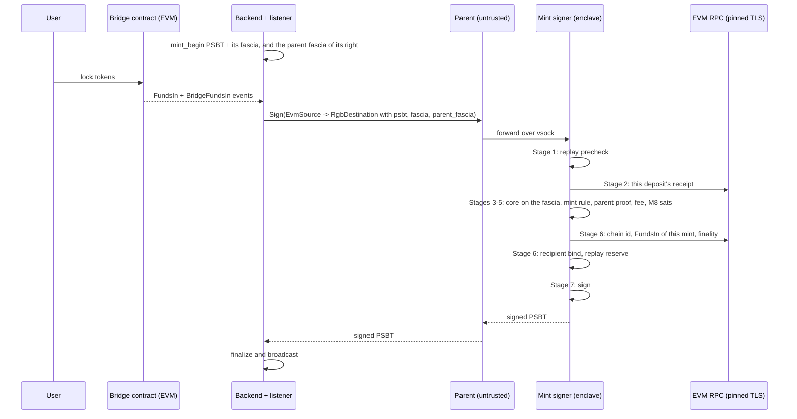

# Mint flow (EVM -> RGB)

- **Signer image:** `mint-signer`
  (`--no-default-features --features vsock,spv,mint-signer`).
- **Checked against repository code:** 2026-11-10, rgb-lib-bfa 5010eefa
  (RGB-Tools bfa 66bae096). Deployment was not checked.

This document gives the checks of the mint signer, in order. The
[specification](tee-spec.md) gives the trust model and the known limits. If
the code and this document differ, investigate the difference. Either can
contain an error.

## 1. What the mint flow does

1. The backend makes an RGB mint (a BFA `mint` transition) with rgb-lib's
   `mint_begin`, and a Bitcoin PSBT that anchors it. It gets the mint's lockId
   and `settlementData = abi.encode(uint256 lockId, uint64 beforeBlock)`. The
   mint commits to `beforeBlock`: its EVM lock must be in an earlier (L2)
   block.
2. The user locks ERC-20 tokens in the Bridge contract on EVM. The `fundsIn`
   call carries that `settlementData`.
3. The Bridge contract writes a `FundsIn` event and a `BridgeFundsIn` event.
   `FundsIn` names the mint's lockId.
4. The backend sends the PSBT, the fascia that rgb-lib wrote for the mint
   transaction, and the fascia of the transaction that made the right the
   mint spends (the parent fascia).
5. The mint signer checks the deposit, the mint, the PSBT and both fascias.
6. The mint signer signs the PSBT with its colored Taproot key.
7. The backend finalizes and broadcasts the Bitcoin transaction.
8. The recipient validates the RGB transfer and waits for the required
   confirmations.

### The lockId

`LockId(opid, txid)` commits a mint to its exact Bitcoin transaction. It is
`SHA256(t || t || opid || txid)` with
`t = SHA256("urn:lnp-bp:rgb:lock#2026-11-04")`. Each id is its 32 bytes, and
the txid is in internal byte order. On EVM the 32 bytes are one big-endian
`uint256`.

Test vector: opid bytes 0x00 to 0x1f and txid bytes 0x20 to 0x3f give
`1ce683c92fdfb3ef54e39c7b461e731dad02cd240b366441f34a2c2e849a9876`.

### The mint transaction cannot change after the lock

The lockId commits the txid. So after the lock there is no RBF, no rebuild
and no batching, and a retry signs the same PSBT. Another transaction for the
same mint names another lock, which M6 refuses.

The fee stays the one that `mint_begin` set. Only a CPFP child that spends an
output of the mint transaction could raise it, and none is implemented: the
bridge rebroadcasts a stuck mint transaction as it is. So the operator must
plan for the transaction to confirm at its original fee. The user output of a
witness mint is the seal that holds the minted units. A child that spends it
without a valid RGB transition destroys the units.

## 2. Who does what

| Part | Where | Trusted for | Job |
|------|-------|-------------|-----|
| User | EVM | - | Locks tokens. |
| Bridge contract | EVM | Deposit records | Holds the tokens. Writes the deposit events. |
| Backend and listener | Operator servers | Nothing | Build the PSBT and its fascia. Find the parent fascia. Send the request. |
| Parent | EC2 host | Nothing | Moves bytes. Relays KMS and S3 traffic for the seed. |
| Mint signer | Nitro Enclave | Checks and keys | Checks the deposit and the mint. Signs the PSBT. |
| EVM RPC | Pinned TLS host | Receipts, canonical blocks and the selected finality head | Gives the deposit receipts and the data for the finality and block-hash checks. |
| Bitcoin indexer | Pinned URL | Nothing | Not read by a mint or a refill. The launch still pins its URL. |

The mint signer ignores the `event_valid` and `event_finalized` flags of the
listener. It checks the deposit itself through the pinned EVM RPC. It trusts
that provider for receipts, canonical blocks and the selected finality head.
It does not verify EVM consensus.

**A deposit that is not final yet.** If the receipt is above the `safe` or
`finalized` head, the enclave refuses with error code 8. The parent turns
that code into `FailedPrecondition` with the fixed prefix
`evm event pending finality:`. The bridge treats it as a wait and retries.
Other validation failures have code 3.

**No consignment.** rgb-lib commits the PSBT and then strips its RGB keys. It
keeps the RGB data in the fascia of the transaction: the unsigned
transaction, every bundle that the transaction commits and the MPC block with
its entropy, strict-encoded. The mint signer reads the mint from that fascia
and validates no RGB history. [Section 11](#11-the-main-idea) says why that
is enough.

The mint image carries `SPV_MIN_CONFIRMATIONS` in its attested policy, but no
mint check reads it. The connector should still mint only on a right whose
send is that deep: a mint on a parent that leaves the chain is invalid until
the parent is mined again.

## 3. Sequence

The RGB fields of a mint and a refill on each hop. Each fascia is the
strict-encoded file that rgb-lib writes, sent as raw bytes. The last column
gives a reserved field number; do not reuse it. A request with a value at
that number and no fascia fails F4.

| Hop | Message | PSBT | Its fascia | Parent fascia | Reserved |
|-----|---------|------|------------|---------------|----------|
| Bridge to listener | `node.RgbSignData` | `psbt` 3 | `fascia` 6 | `parent_fascia` 7 | 5 |
| Listener to parent | `parent.EnrichedRgbPayload` | `psbt_bytes` 2 | `fascia` 9 | `parent_fascia` 10 | 8 |
| Parent to enclave, mint | `enclave.RgbDestination` | `psbt_bytes` 2 | `fascia` 9 | `parent_fascia` 10 | 8 |
| Parent to enclave, refill | `enclave.SignRightsRefillRequest` | `psbt_bytes` 1 | `fascia` 6 | `parent_fascia` 7 | 5 |

## 4. Key values

| Name | Value | Meaning |
|------|-------|---------|
| `TS_MINT` | 8013 | Mint transition. The only transition a mint may commit. |
| `TS_PROPAGATE` | 8014 | Moves one mint right to new rights. The only transition that may make a right a mint spends (PP4). |
| `OS_ASSET` | 4000 | Output that holds RGB units (u64). |
| `OS_MINT` | 4013 | The mint right (`mintRight`). It holds no units. |
| `GS_ISSUED_SUPPLY` | 2010 | Mint global: the units it issues. |
| `MS_BEFORE_BLOCK` | 1003 | Mint metadata: the lock must be in an earlier EVM (L2) block. |
| `RGB_CHAIN_ID` | 827166 | The bridge's id for the RGB network. Compiled in. |
| `MINT_INPUTS` | 1 | A mint spends its right alone. |
| `MAX_FEE_RATE_SAT_VB` | 200 | Maximum fee rate, over the unsigned size. |
| `MAX_FEE_SATS` | 100,000 | Maximum fee. |
| `MIN_FEE_RATE_SAT_VB` | 1 | Minimum fee rate, over the estimated signed size. |
| MPC tree depth | 3 | The depth that rgb-lib commits with. F5 rebuilds the tree at it. |
| Colored account | `m/86'/827166'/0'` on mainnet | The only account that signs a mint. |
| Amount rule | `OS_ASSET == issuedSupply == amount - commission` | Exact. Not a minimum. |

`EVM_FINALITY_TAG`, `SPV_MIN_CONFIRMATIONS` and `MINT_WITNESS_SAT` are image
settings ([configuration.md](configuration.md)). The size limits and the
replay window named below are runtime limits
([runtime-limits.md](runtime-limits.md)).

## 5. Checks, in order

If one check fails, the mint signer stops. It signs nothing. It returns an
error.

The stages group the checks by topic. The code order differs in places: F7
and the fee check run after M1 - M5 and M7, and the fee check runs after the
parent proof. Stage 2 parses the invoice of S6.2; only the seal compare
runs in Stage 6. Section 3 and [diagram 04](diagrams/04-seq-sign-psbt.md)
show the code order.

### Stage 0 - Can this enclave do this request?

- **S0.1** The launch values must be set (`SetEndpoints`).
- **S0.2** The source must be EVM and the destination must be RGB. The mint
  signer refuses a burn request.
- **S0.3** The key must be ready (the enclave is `Active`). Otherwise the
  signer refuses with `KeyNotInitialized`, before the replay check and any
  network call.

### Stage 1 - Is this a repeat?

- **S1.1** The mint signer makes a replay key from `chain_id`, the proxy
  contract, `evm_tx_hash`, `funds_in_operation_id` and the asset id.
- **S1.2** If the replay guard still holds this key, the signer refuses the
  request. This check records nothing. It runs before any network call. A
  retry of the same request normally does not reach the enclave: the parent
  answers it from the reply that it kept (S7.6).

### Stage 2 - Is this deposit real?

The mint signer gets the receipt itself, through TLS to the pinned EVM RPC
host. TLS ends inside the enclave. Each call has the timeout
`evm_rpc_timeout_secs`.

- **S2.1** `evm_tx_hash` and `funds_in_operation_id` must each be 32 bytes.
- **S2.2** The receipt must exist and must be a success.
- **S2.3** The receipt must have exactly one `BridgeFundsIn` event from the
  pinned `FUNDS_IN_CONTRACT` whose `operationId` (topic 1) is the request's
  `funds_in_operation_id`. Zero or two such events: refuse. Other deposits in
  the transaction are ignored. There is no fallback to the plain `FundsIn`
  event, which carries a lockId, another id space.
- **S2.4** All 32 bytes of the event `operationId` must equal the request's
  `funds_in_operation_id`.
- **S2.5** The event `amount` must equal the request amount. The event
  `tokenCommission` must equal the request commission.
- **S2.6** `netAmount` must not be more than `amount - commission`.
- **S2.7** Each amount must fit in a u64. The mint signer does not cut a
  larger value. It refuses it.
- **S2.8** The head that `EVM_FINALITY_TAG` selects must cover the receipt,
  and the receipt's `blockHash` must match the canonical block at its height.
  The enclave reads the head again afterwards to detect a reorg. A receipt
  above the head, or missing tag data, refuses signing. A pending deposit can
  be retried once the head covers it.

### Stage 3 - Does the PSBT commit exactly one transition of the asset?

The core. It reads the RGB data from the request's `fascia`, never from the
PSBT: RGB keys left in a PSBT are ignored. It also runs on the parent fascia
and the transaction that it carries (PP2), where M0, F1, F2 and F7 do not
apply: the enclave does not sign the parent.

- **M0** The mint transaction has at most `mint_max_inputs` inputs and
  `mint_max_outputs` outputs. The enclave checks this before it decodes a
  fascia.
- **F1** The PSBT must parse and have at least one input.
- **F2** Each input must have a `witness_utxo` with a native witness
  program, so the unsigned txid is the final txid. Each sighash type must be
  `SIGHASH_ALL` or Taproot `DEFAULT`.
- **F3** The first output that is an `OP_RETURN` or a P2TR must be an
  `OP_RETURN`. RGB consensus reads the commitment from that output. A P2TR
  first would make it a tapret host that the opret check never sees. P2A is
  not P2TR.
- **F4** `fascia` must not be empty and must decode as rgb-lib reads its
  fascia file: strict encoding, nothing after it, at most `max_psbt_bytes`.
  Its witness txid must be the PSBT's unsigned txid. It discloses exactly one
  bundle, of the contract that `RGB_ASSET_ID` names. The request's `asset_id`
  must name it too.
- **F5** The MPC tree of every bundle that the fascia discloses, under the
  entropy that the fascia carries, must give the 34-byte `OP_RETURN`
  commitment. A fascia without the entropy is refused. So the fascia shows
  exactly the bundles that the transaction commits: a hidden, extra or
  swapped bundle changes the commitment. The enclave does not read the DBC
  proof of the fascia: it checks its own opret proof, and F3 rules out a
  tapret.
- **F6** The bundle holds exactly one transition of the pinned contract,
  stored under its own id, which the enclave recomputes. The input map must
  close exactly the inputs of that transition. rgb-lib moves any other
  allocation of the spent UTXO by a transition of its own in the same
  bundle. So a link right must not share a UTXO with mint rights: F6 refuses
  that mint or refill.
- **F7** The PSBT spends exactly one input (`MINT_INPUTS`), a Colored
  key-path input of the enclave. So the UTXO of the right must pay the fee
  and, for a witness mint, `MINT_WITNESS_SAT`. If that UTXO is too small for
  the fee rate, rgb-lib adds a second input and F7 refuses the mint. The
  bridge must refuse such a mint before `mint_begin`.
- **Fee**:
  - not more than `MAX_FEE_SATS`;
  - not more than `MAX_FEE_RATE_SAT_VB` over the unsigned size, which the
    host cannot pad;
  - not less than `MIN_FEE_RATE_SAT_VB` over the estimated signed size;
  - if the enclave cannot estimate the size of an input, it refuses.

The mint signer takes no fee estimate from outside. A changing estimate could
block a mint after its deposit is final. The bridge must check the market fee
before the user locks tokens. The fee limits are compiled in, so a change
needs a new image.

### Stage 4 - Is it a mint of exactly the deposit?

- **M1** The transition type must be `TS_MINT`.
- **M2** It must close exactly one input, an `OS_MINT`.
- **M3** It assigns `OS_ASSET` only. It passes no `mintRight` on (a mint uses
  up its right) and makes no link.
- **M4** Its globals are exactly `issuedSupply`: one value of 8 bytes, a
  little-endian u64 above 0. Its metadata is exactly `beforeBlock`: 8 bytes,
  a little-endian u64.
- **M5** The `OS_ASSET` units must equal `issuedSupply`, and **exactly**
  `amount - commission`. A larger sum is an over-mint.
- **M7** There is exactly one `OS_ASSET` leg: on a blinded seal (the
  depositor's), or on a witness seal that is an output of this transaction (a
  witness invoice). A seal on an output of another transaction is refused:
  the enclave cannot see what that output pays.
- **M8** The sats that the mint pays out. It runs on the PSBT after the
  parent proof (Stage 5) and the fee check, and before M6 reads the deposit.
  - A blinded mint pays no sat out. Every output is a BIP-86 key-path output
    that the enclave derives at a wallet path (rule C of
    [section 7](#7-plain-btc-signbtc)), or carries 0 sat, as the `OP_RETURN`
    must.
  - A witness mint pays exactly `MINT_WITNESS_SAT` to the output of its seal.
    That output must exist, must not be an `OP_RETURN`, and must not be the
    enclave's own (rule A or rule C). Every other output is the enclave's by
    rule C, or carries 0 sat; rule A gives no exemption here. The change may
    be missing.
  - The connector and the enclave must use the same `MINT_WITNESS_SAT`. The
    PSBT pays the connector's value, fixed at `mint_begin`, and a mismatch is
    refused here, after the user's lock. The attestation does not carry the
    value, so the deploy must compare the two before a release takes witness
    invoices.

### Stage 5 - Does the mint spend the right its parent made?

The parent fascia (`parent_fascia`) is the fascia that rgb-lib wrote for the
transaction that made the spent right. It carries that transaction unsigned.
The txid of a native SegWit transaction does not change when it is signed.

- **PP1** `parent_fascia` must not be empty and must decode as in F4.
- **PP2** The core (F3 - F6) runs on it and the transaction it carries, with
  the same asset pin. It gives the parent's txid, OpId and transition.
- **PP3** The mint's one input must be an `OS_MINT` output of that
  transition.
- **PP4** The parent must be a `TS_PROPAGATE` that closes exactly one right.
  A transfer, mint or genesis parent is refused.
- **PP5** That right must sit on a witness seal: an output of the parent
  transaction itself. The parent's id commits its seal, so the recompute in
  PP2 authenticates the output number.
- **PP6** No other revealed assignment of the parent sits on that output.
- **PP7** Exactly one PSBT input spends that output. For a mint it is the
  only input (F7).

### Stage 6 - Is the deposit this mint's, and the user the right one?

- **M6** The deposit must name this mint and this transaction:
  - The EVM node must report `EVM_CHAIN_ID`. `TOKEN_CONTRACT` and
    `EVM_CHAIN_ID` must be pinned, which the enclave checks before the RPC
    calls of M6.
  - The receipt of `evm_tx_hash` must have exactly one `FundsIn` event from
    `FUNDS_IN_CONTRACT` whose `lockId` is `LockId(opid, txid)` of this mint
    and the PSBT's transaction, with `issuedSupply` as its amount.
  - It must have exactly one `BridgeFundsIn` event whose `operationId` is the
    deposit id that the mint derives from its lockId and `issuedSupply`
    ([burn-flow.md](burn-flow.md), B2.4). That id must be the request's
    `funds_in_operation_id`, which S2.3 bound. Its `netAmount` must equal
    `issuedSupply`. Other deposits in the transaction are ignored.
  - `destinationChainId` must be `RGB_CHAIN_ID`.
  - The receipt block must be before `beforeBlock`, at or below the head
    that `EVM_FINALITY_TAG` selects, and its `blockHash` must match the
    canonical block at its height. The enclave reads the head again
    afterwards to detect a reorg. A receiving rgb-lib wallet confirms the
    mint only once the lock is `finalized`.
- **S6.1** The amount must cover the minted units plus the commission. The
  enclave takes the minted amount from the fascia.
- **S6.2** If the deposit event has a `destinationAddress`, it is an RGB
  invoice. Only a blinded seal is accepted, and it must equal the M7 seal. A
  witness mint has no blinded seal, so a deposit with an invoice refuses it.
- **S6.3** If the `destinationAddress` is empty (the v2 Bridge), the deposit
  binds the user through the mint's lockId (M6). The mint transition commits
  to its seal, and the transaction to the script on the output of a witness
  seal (section 11).
- **S6.4** The mint signer reserves the replay key.

### Stage 7 - Sign

- **S7.1** There is no unowned-sats budget. M8 is the only sats gate.
- **S7.2** The mint signer signs only inputs of the colored account. It uses
  Taproot key-path signatures with BIP-86 account keys. A Tapret or
  script-tree root can be part of the tweak. It never makes a script-path
  signature.
- **S7.3** For each input, the derived key must equal the internal key, and
  the tweak must give the output key. A false origin claim fails here.
- **S7.4** Zero signed inputs is an error.
- **S7.5** The response is `SignedPsbtResponse { signed_psbt, inputs_signed }`.
  The PSBT is not finalized.
- **S7.6** The enclave commits the replay key only after it wrote the
  response. A failed write releases the key. A successful write does not
  prove that the caller received the response. So the parent keeps the reply
  of an EVM -> RGB sign for `SIGNED_RESPONSE_TTL_SECS` and answers a retry of
  the same request itself. A retry of a request still in flight waits for
  that exchange and gets its reply. A retry of a request that the enclave
  already signed reaches the enclave only when the parent has no reply for
  it: the parent did not read the reply, the reply was above
  `SIGNED_RESPONSE_MAX_BYTES`, the parent dropped it at
  `SIGNED_RESPONSE_MAX_ENTRIES` or `SIGNED_RESPONSE_MAX_BYTES`, the reply is
  older than `SIGNED_RESPONSE_TTL_SECS`, or the parent restarted. The enclave
  refuses that retry while its replay guard holds the key (section 6).

## 6. Replay

The replay guard is in memory and per enclave. It does not survive a restart,
and replicas do not share it. It holds a key for `mint_replay_ttl_secs`, and
`mint_replay_max_entries` can remove the oldest keys earlier. The parent
keeps each reply and answers a retry of the same request from it, so a lost
response does not strand a deposit for the window.

The guard is not the safety control. The parent proof is: every signature
for one mint transition spends the output that PP7 pins. Two signed
transactions for one deposit that use the same parent spend the same output,
and Bitcoin confirms at most one. The enclave does not compare parents across
requests, and it does not check what a parent transaction spends (section
8). A different parent transaction is valid for a receiver only if it spends
the inputs of the real parent again, so it conflicts with the real parent on
Bitcoin. The same transition committed again in a transaction that spends
another Colored UTXO is refused (PP7). A new transition for the same deposit
is refused too: the deposit names one lockId (M6).

## 7. Plain BTC (`SignBtc`)

The mint signer also signs plain Bitcoin PSBTs, for example to make UTXOs. It
is a request of its own: a `Sign` request cannot reach this path.

- On a `Production` policy the attested policy must allow it
  (`allow_vanilla_psbt`), which needs a non-zero `BTC_MAX_TOTAL_SATS`. On any
  other policy the enclave still refuses every request while
  `BTC_MAX_TOTAL_SATS` is 0.
- Only the vanilla account signs. A colored input is never signed here.
- The total input value must not be more than `BTC_MAX_TOTAL_SATS`.
- Outputs that the enclave does not own must total at most
  `BTC_MAX_UNOWNED_SATS`.
- The fee limits of Stage 3 apply. An input whose size the enclave cannot
  estimate refuses the request.

The enclave derives ownership from its keys. There is no configured list of
scripts. An output is the enclave's own in two cases:

- **Rule A.** Its script equals the script of an input that the enclave can
  sign: a Taproot key-path input whose internal key derives from a BIP-86
  account and, with its tweak, gives the output key. A script tree can hold
  foreign spend paths, so the exemption is limited to the input value on that
  script. In `SignBtc` only inputs of the vanilla account count. M8 counts
  inputs of either account.
- **Rule C.** It is a BIP-86 key-path output of an enclave account, with no
  script tree, at a wallet path `[k, i]`: both steps non-hardened, `k` = 0 on
  the colored account and 0 or 1 on the vanilla account. The PSBT output
  must carry the internal key and its key origin. The enclave derives the key
  at that path and rebuilds the script. An output without this data, and an
  enclave key at any other path, count as not owned.

An enclave key in one Taproot leaf proves nothing about the rest of the
tree, so no rule accepts it.

There is no rate limit. Each limit bounds one request, and the change goes
back to a vanilla output that the host can submit again. So a compromised
host can turn the whole vanilla balance into fees, at most `MAX_FEE_SATS`
per signature, and pay up to `BTC_MAX_UNOWNED_SATS` to its own address on
each request. The bound on the sum belongs outside the enclave.

## 8. Rights refill (`SignRightsRefill`)

A mint uses up its right, so the connector refills its pool itself. It sends
one of its own rights to K of its own witness invoices, with K from
`MIN_REFILL_RIGHTS` (2) to `MAX_REFILL_RIGHTS` (255). The mint signer signs
that send under a rule of its own. No deposit backs it, so the rule checks
shape only: every new right and every sat stays on the enclave's own outputs,
and no units move.

The parent maps `data_type` `RGB_RIGHTS_REFILL` to `SignRightsRefill`
(`psbt_bytes`, `asset_id`, `fascia`, `parent_fascia`). It refuses a request
with a source proof or without `RgbData`. The reply is `SignedPsbtResponse`.
Like every signing request it waits for `SetEndpoints`, but it reads no
network.

The cheap checks run first.

**Gate** (PSBT and keys only):

- **RR0** The PSBT has 1 or 2 inputs: the seal of the right and at most one
  fee input (`MAX_REFILL_FEE_INPUTS`). Each extra input could destroy the
  state it carries.
- **RR10** Every input is a Colored key-path input of the enclave (the
  custody check of S7.3).
- **RR12** M8 of a blinded mint: no sat leaves. An output that repays an
  input script gets no exemption here.
- **RR13** The fee limits of Stage 3.
- **RR15** At most `MAX_REFILLS_PER_HOUR` (12) requests in any sliding hour
  get past this point. The count is in memory and per enclave, and a restart
  resets it. A request that the gate refuses does not count. A request
  refused later does.

**From the PSBT and its fascia** (the core of Stage 3):

- **RR5** F2, F3 and F5. F3 matters most here: RR12 admits 0-sat outputs, and
  a 0-sat P2TR before the `OP_RETURN` would switch the commitment method.
- **RR3** F4 and F6: the refill's own fascia, of the pinned asset.
- **RR6** The one transition is a `TS_PROPAGATE`.
- **RR7** It closes exactly one input, an `OS_MINT`. It assigns `OS_MINT`
  only, each right with no state, and has no globals and no metadata.
- **RR8** It makes 2 to 255 rights. Each is on a witness seal (an output of
  this transaction), never on a blinded seal or an output of another
  transaction, and no two share an output.
- **RR11** PP1 - PP7 on the right it closes: exactly one input spends the
  UTXO of the right. The other input, if any, is the fee input (RR0).

**Keys:**

- **RR9** The output of each right is a Colored BIP-86 key-path output of
  the enclave at child path exactly `[0, i]`, both steps non-hardened: the
  keychain that rgb-lib scans. A right on a host key could mint against a
  deposit that the bridge also mints. A right on a Vanilla output is
  invisible to rgb-lib, and `SignBtc` could spend it.
- **RR14** S7.2 - S7.4: the Colored inputs are signed. Zero signed inputs is
  an error.

The rule numbers RR1, RR2 and RR4 are not used: a refill carries no
consignment, so no consignment size, hash, consensus or reject-list check
runs on it.

**Where the fascias come from.** rgb-lib writes each fascia as the `fascia`
file of the transfer directory. A mint's own fascia is that of its mint
transfer. A refill's is the one its send returns. For a right that a refill
made, the parent fascia is that refill's. For a right that the issuer seeded,
the operator places the issuer's fascia once, at seeding. A fascia must be
strict-encoded; PP1 refuses a JSON fascia.

What a refill does not check, and why that is safe:

- **No deposit and no replay key.** No units move, and Bitcoin stops a second
  spend of the right: PP7 pins it.
- **The fee input (accepted residual).** A hostile host can fund a junk
  transaction that pays a Colored address of the enclave and commits a
  well-formed but invalid propagate. The parent proof passes on it. A refill
  then closes the "right" that this junk propagate made, and spends a real
  right as its fee input, which destroys it: one right per refill. One junk
  transaction is enough: the parent proof accepts any refill fascia, so each
  junk refill is the parent of the next, and the fees come from the
  enclave's Colored sats. The host cannot take a right: every new right is
  the enclave's (RR9) and every sat stays (RR12). RR15 is an in-memory rate
  per enclave process, not a total: at `MAX_REFILLS_PER_HOUR` the host can
  destroy the rights of a full mint wallet in about a day, and faster after
  a relaunch or with a second replica. Minting then stops until the issuer
  sends new rights. With a real parent the count of rights never drops.
- **Concealed assignments.** PP6 cannot see a concealed assignment of the
  parent. The parent is an enclave refill (RR7 and RR8: rights only, all
  revealed) or the issuer's send to witness invoices.
- **Fees.** Each refill signature can burn at most the fee limits of Stage 3
  (RR13). RR15 bounds how many signatures an enclave makes in an hour.

The refill limits are compiled in, so PCR0 measures them.

## 9. What the mint signer refuses

| Request | Result |
|---------|--------|
| `Sign` with an RGB source or an EVM destination (burn) | Refused: wrong signer role. |
| `SignRawDigest` (gas transaction) | Refused: wrong signer role. |
| `InitiateCloning`, `GetClone`, `SetClone` | Refused: the seed comes from KMS. |
| `Sign` without `fascia` | Refused (F4). rgb-lib strips the PSBT, so there is nothing else to read. |
| `Sign` without `parent_fascia` | Refused (PP1). |
| `SignRightsRefill` without `fascia` or `parent_fascia` | Refused (F4, PP1). |
| `SignRightsRefill` that breaks a rule of section 8 | Refused. Past the gate it still counts against the hourly limit. |
| `SignRawMessage` | Refused in every build. |

## 10. Seed

The mint signer gets its seed from AWS KMS. The encrypted seed is in S3. Mint
replicas recover the same seed. See [KMS seed persistence](kms-persistence.md).

## 11. The main idea

A mint spends one mint right (`OS_MINT`, no units) and makes units
(`OS_ASSET`). It passes no right on, so each mint uses up a right.

**The txid fixes what the mint does.** Each step from the signed txid to the
transition is a commitment:

1. The signature commits to the unsigned transaction. Native SegWit inputs
   keep the txid fixed (F2).
2. The fascia is of that transaction: its witness txid is the PSBT's txid
   (F4).
3. The first `OP_RETURN` or P2TR output is an `OP_RETURN` (F3). RGB consensus
   reads the commitment from that output.
4. The enclave rebuilds the MPC tree from every bundle that the fascia
   discloses and checks it against that `OP_RETURN` (F5).
5. The bundle id commits the input map. Each entry must name the one
   disclosed transition, whose id the enclave recomputes (F6).

**The amount is checked three times**, from the fascia and the deposit:

1. The mint rule: the one `OS_ASSET` leg equals `issuedSupply` (M5).
2. The deposit: its `FundsIn` names this mint's lockId, and the deposit id
   that the mint derives carries `issuedSupply` (M6). The units equal
   `amount - commission` (M5).
3. The recipient: the one leg (M7) is the depositor's blinded seal when the
   deposit carries an invoice (S6.2). Otherwise the lockId binds it (S6.3).

**History decides whether a mint takes effect, never what it does.** A
receiver validates the full history when it accepts the mint, so a bad
history makes the mint invalid for everyone. It moves no other state of the
wallet and inflates nothing. So the enclave checks no history, and each
missing check is a liveness limit only:

- No consensus over the history, and no genesis or schema check. The pinned
  contract id commits the genesis. A genesis `bridgeLocation` that differs
  from the funds-in pin is an operator error: receivers look for the lock on
  the genesis bridge and refuse the mint.
- No ancestor mint check. The burn signer derives each deposit.
- No witness depth. The mint signer checks no witness transaction of the
  history.
- No reject list. The connector's rgb-lib checks it before `mint_begin`.
- No invoice expiry. S6.2 does not check the expiry of an invoice, and a v2
  deposit carries no invoice. So the enclave can sign a mint after the
  invoice expired. A wallet fails a receive that it has not checked when the
  invoice expires. The connector checks the time left when it prepares the
  mint (`MINT_INVOICE_MIN_TTL`), but slow blocks can still pass the expiry.

A host that controls the bridge can therefore make a mint that no receiver
accepts, after the user locked. It cannot mint units that no deposit backs,
and it cannot move other state of the wallet: the parent proof pins the one
UTXO that the mint spends.

**A propagate parent keeps every mint out of a mint's history.** Rights
reach the mint wallet only by issuer sends or refills, every refill passes
PP4, and M3 stops a mint from passing a right on. The mint wallet must hold
no right whose parent is a mint or the genesis.

**A witness mint's output script is bound by the lockId.** A witness seal
names an output number of the mint transaction, and the OpId commits that
number, not the script on it. The lockId that the deposit names also commits
the mint txid. So the same mint in a transaction that pays another script
names another lock, and M6 refuses it. The user still locks the lockId that
the bridge hands out, so the bridge must name the transaction that pays the
user. M8 keeps the units off the enclave's own outputs and bounds the sats
that leave to `MINT_WITNESS_SAT`.

**The receiving wallet can still refuse a mint.** rgb-lib's receive also
checks limits on the receiver's own wallet state: the allocations on the
receiving UTXO, and the total amount of the asset. The enclave cannot see
that state. rgb-lib runs these checks when it first processes the mint and
again when the lock is final. A refusal fails the receive for good, while
the connector still signs, broadcasts and completes the mint. After the lock
this is more than a liveness limit: the user loses the mint. The units sit
on a seal that the wallet does not track, the deposit stays in the Bridge
with no refund, and it cannot back another mint, because the lockId commits
this one. Before the lock a refusal costs nothing. So a caller should lock
only once the wallet reports the mint with the returned lockId
(`ReceivedMint.lock_id`). A witness
mint pays a new output, which starts with no allocations, so these limits
apply mainly to blinded mints.

The fascia is read in the strict encoding of the pinned `rgb-ops`. A change
of that encoding fails F4 and PP1: every mint and refill is refused until the
enclave moves with rgb-lib.
